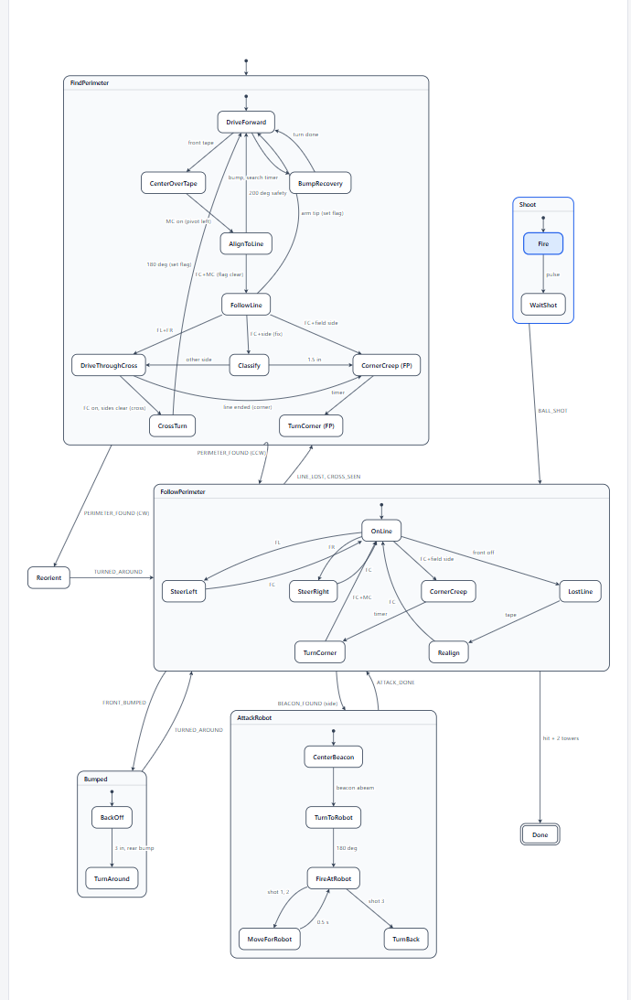

# ECE 118 final robot

Software design for our ECE 118 final-project robot: an Uno32 running the course Events and Services (ES) framework. [design.md](design.md) has every state table, edge case and tuning constant. This page is the short version: the state machine and why it's built this way.

The robot follows the tape perimeter counterclockwise, shoots each tower's marked hole from the line, and shoots the dead robot when its side detector sees the beacon. If something blocks the tape, it goes back the other way around the loop.

Win rates below come from our Robot Sim, over 300 random fields.

## State machine

A top-level state machine runs one sub-machine at a time. Sensor services and event checkers post events, each handler runs to completion, and every wait is a timer.

| State | What it does | Leaves on |
|---|---|---|
| **FindPerimeter** | Finds the tape from anywhere on the field without mistaking the center cross for it | `PERIMETER_FOUND`: to FollowPerimeter if counterclockwise, to Reorient if clockwise |
| **Reorient** | Turns around once so the shooter faces out | `TURNED_AROUND` |
| **FollowPerimeter** | Follows the tape and turns corners. This is the main state | `MARK_SEEN` to Shoot, `BEACON_FOUND` to AttackRobot, `FRONT_BUMPED` to Bumped, `LINE_LOST` or `CROSS_SEEN` to FindPerimeter |
| **Shoot** | Fires at the tower from where it stopped and waits for the ball to clear | `BALL_SHOT` |
| **AttackRobot** | Centers on the beacon, turns 180°, fires three shots, turns back | `ATTACK_DONE` |
| **Bumped** | Backs off 3" and heads back the other way | `TURNED_AROUND` |
| **Done** | Stops the robot | Nothing |

**FindPerimeter.** The robot drives until the front row hits tape, creeps until the wheel axis is on it, then pivots left until the front and middle sensors line up. `FollowLine` then works out what the line is:

- An arm tip sets the "next line is the perimeter" flag, and the robot drives on.
- At a crossing, `DriveThroughCross` watches what happens next. If the line carries on, it was the center cross, so `CrossTurn` turns 180° and sets the flag. If the line ends, it was a corner.
- `Classify` settles the ambiguous "center plus one side" reading. If the other side lights, it's a crossing. If 1.5" goes by without that, it's a corner.

**AttackRobot.** `CenterBeacon` creeps until the beacon leaves the detector's narrow slit, then backs up half that distance, which puts the beacon directly abeam. `TurnToRobot` pivots 180° so the shooter looks along the line the detector just saw. `FireAtRobot` and `MoveForRobot` alternate for three shots, and `TurnBack` restores the heading.

### Reading the diagram

The diagram lags design.md in a few places:

- It doesn't draw the FollowPerimeter to Shoot arrow, which fires on `MARK_SEEN`.
- `Bumped` still shows the pivoting `TurnAround`. Since v14 the robot drives backward instead.
- `OnLine` still shows "FC + field side" as a corner. Since v9 a corner means the front row ran off the end of the edge.
- `Done` shows "hit + 2 towers". Since v12 the robot keeps going until the balls run out, so a missed tower can still be shot on a later lap.

## Design choices

| Choice | Why |
|---|---|
| Side shooter, counterclockwise travel | The shooter on the right faces the towers, and the beacon detector on the left sweeps the field the whole time the robot drives. |
| Never leave the tape to shoot | The earlier ram-and-retrace attack could lose the line or cross the field. Now the robot only creeps along the tape and turns in place. |
| Timed 180° turns when attacking | Ending the turn on tape landed up to ±13° off, enough to miss an 11" robot at 3–4 ft. This makes `MS_PER_DEG` the most important calibration. |
| Three shots with a 0.5 s move between | Spreads the shots about 2" apart, so at least two hit even if the aim is a little off (2.7 hits per attack). |
| Six balls: three held for the dead robot | Towers can't use up the attack. A tower already shot (same edge, within 10") isn't shot again, and any other tower is never skipped. |
| Side sensor reads the tower's banner | It sits directly below the shooter, so seeing the banner means the shooter is on the marked hole. Dropping the track-wire search was faster and removed the disqualifications from creeping near corners. |
| Hold beacon and tower events during corners | Acting in the middle of a corner caused disqualifications. The event waits until the robot is straight on the tape. |
| 1.5" sensor spacing | The earlier 2.5" spacing left blind gaps on a 2" line, so normal drift read as "line lost". Overlapping sensors raised wins from 72% to 79%. |
| Steer from both sensor rows | Front plus back gives sideways offset, and front minus back gives angle, so the robot straightens itself on every edge. |
| Drive backward after a bump | The shooter keeps facing out and the detector keeps facing in. Every machine runs unchanged on a "virtual robot" with its rows, wheels and bumpers swapped. |
| Filter the tape sensors | Subtracting an LEDs-off reading cancels room light. A moving average, hysteresis and a two-sample check stop flicker at the tape edge. |
| Sub-machines report by returning events | The top level handles a result in the same call, before anything else in the queue. Each sub-machine also restarts from its first state on every visit. |

With the current design (v14), the robot wins 95% of random fields, or 91% with the dead robot right up against the perimeter.
