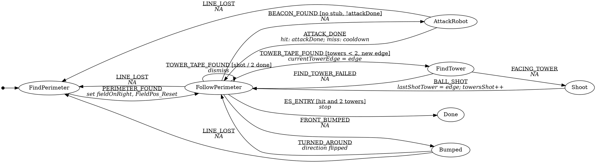

# ECE 118 Final Robot — Software Design

Design for the final-project robot on the Uno32 stack, using the course **Events and Services (ES) framework**: event checkers and services post events, a top-level hierarchical state machine (HSM) runs one sub-HSM at a time, and everything is run-to-completion and non-blocking.

This is a design document with rough pseudocode, not final code. Names follow the ES templates (`RunTopHSM`, `InitFollowSubHSM`, `ES_Timer_InitTimer`, `ES_ENTRY` / `ES_EXIT`, …). Check exact library names against your headers.

**Tags used below**
- **[ASSUMPTION]** something I had to assume; confirm it.
- **[TUNE]** a number to measure on the real robot or field.
- **[OPEN]** a decision still to make (all collected in §14).

**Sources:** the team notes file (HSM, all FSMs, edge cases), the whiteboard and notebook sketches, the Onshape field sketch, Lecture 01 (event-driven programming, ES framework, hysteresis), Lectures 02–03 (sensors, filtering), Lectures 07–08 (digital I/O, solenoids, DC motors, H-bridge, snubbing), the TCRT5000 datasheet, the Lab 0 roach work (debounce, hysteresis, HSM, timer and TattleTale lessons) and Lab 1 (beacon / track-wire detectors). Course handouts in `helpful_files`: *Events and Services Framework*, *Creating an ES Framework Project*, *Debugging the ES Framework*, *Uno32 I/O Board*, *L298N Dual H-Bridge*, *DS3658 Quad Low-Side Driver*, *DRV8811 Stepper*, *New MPLAB-X Project*, *GVEdit* and `StateMachineTemplate.gv`. The HSM matches `ECE_118_Final_HSM_v2.pdf` (turn-around Bumped, two-tower limit).

---

## Contents
1. Mission and overview
2. Field and robot model
3. Hardware and I/O
4. Signal conditioning and filtering
5. Software architecture (ES framework): how ES works, files, `ES_Configure.h`, events, timers, project setup, bring-up, debugging, diagrams
6. Motion layer
7. Shared building blocks
8. Top-level HSM (direction check, input table, gaps)
9. Sub-HSMs, exactly as drawn (input → next state for every state)
   - 9.1 Find perimeter
   - 9.2 Follow perimeter
   - 9.3 Attack robot
   - 9.4 Find tower
   - 9.5 Shoot
   - 9.6 Turn-around (Bumped v4)
   - 9.7 Sub-HSM pseudocode pattern
10. Edge cases (master list)
11. Tunable constants
12. Test and calibration plan
13. Decisions made in this document (changes from the notes)
14. Open questions
15. Known limitations
- Appendix A: Top-level HSM in GVEdit format

---

## 1. Mission and overview

The robot must:
1. Find the tape perimeter from wherever it starts, without mistaking the center cross for it.
2. Drive around the perimeter in one direction (see §2.2 and §8.1), staying on the tape.
3. When the side beacon detector sees the dead robot's beacon, turn 180° in place so the side shooter faces it, fire 2 balls, turn back (§9.3).
4. When a tower is detected, creep along the tape until the side tower-tape sensor sees the marked hole, then fire into it (§9.4). The robot never leaves the tape to shoot.
5. When something blocks the perimeter, turn around and cover the rest of the loop the other way, without re-shooting a tower it already shot.
6. Stop once the robot is hit **and** two towers are shot. If both towers are shot first, keep circling (dismissing every tower) and only watch for the beacon.

```
Startup
  └─ Find perimeter ──PERIMETER_FOUND──► Follow perimeter ◄──────────────────────┐
                                           │  │  │                               │
                         FRONT_BUMPED ─────┘  │  └───── TOWER_TAPE_FOUND         │
                              │               │               │                  │
                              ▼          BEACON_FOUND         ▼                  │
                   Bumped (turn around)       │          Find tower ──FACING_TOWER──► Shoot
                              │               ▼                                  │      │
                        TURNED_AROUND  Attack robot ──ATTACK_DONE──────────────┤  BALL_SHOT
                              └──────────────────────────────────────────────────┘──────┘
        v8: never skip a tower — no Done; keep circling and shooting every tower until the match ends
```

---

## 2. Field and robot model

### 2.1 Numbers

| Item | Value | Source / status |
|---|---|---|
| Robot footprint | 11" × 11" (half = 5.5") | Notes |
| Opponent footprint | 11" × 11" | Notes |
| Perimeter tape width | ~2" | Onshape sketch [TUNE] |
| Cross arm tips to perimeter tape | ~24" | Onshape sketch [TUNE] |
| Pivot corner swing past the face | ~2.3" (11" robot: corner radius 7.8" vs 5.5" face) | Geometry |
| Towers | Just outside the field, top and bottom | Notes |
| Dead robot | Against the bottom perimeter, inside the tape | Notes |

### 2.2 Direction convention
- **v5 (side shooter):** the shooter is on the robot's right and the beacon detector on its left, so the robot should drive **counterclockwise** (field on its left). Find perimeter's align turn now always pivots **left**, and if it still locks on clockwise, the top level turns it around first (Reorient, §8.4). A bump turn-around (§9.6) still flips the direction; until the next flip, towers and the beacon are ignored.
- The robot can drive **both** ways: it flips on every bump (§9.6). So every left/right label in the diagrams has to be read as "toward the field" / "away from the field" (§8.1).
- Clockwise = field on the right, corners are right turns, tower on the left. Counterclockwise = the mirror image.
- Every turn in the code is written as **toward the field** or **away from the field**, using the runtime `fieldOnRight` flag (§6.2).
- Find perimeter's align turn decides the direction: pivoting right onto the tape from inside gives clockwise; pivoting left gives counterclockwise.
- Where this document says FL/FR or left/right without qualification, it means the clockwise case; mirror them for counterclockwise.

### 2.3 Sensor geometry
```
              FRONT (shooter side, front bumper)
                  FC                  FC sits 0.5" further forward than FL/FR (v6)
        FL ───────┴─────── FR        front row, ~4.5" ahead of the wheel axis; 1.5" between neighbours
                   │
                   MC                 middle sensor, ON the wheel axis (pivot point)
                   │
        BL ───────┬─────── BR        back row, ~4.5" behind the wheel axis; 1.5" between neighbours
                  BC                  BC sits 0.5" further back than BL/BR
              BACK (back bumper)
```
- **v6 geometry:** neighbours are **1.5" apart** (narrower than the 2" tape), and the middle sensor of each row is **0.5" further out** (FC ahead, BC behind).
  - **Why:** with the old 2.5" spacing there were 0.5" blind gaps between sensors where the line lit nothing. Normal drift then read as "line lost" or "end of a cross arm", so the robot never lined up cleanly.
  - With 1.5", the sensors overlap: some sensor always sees a 2" line.
- **What the patterns mean now:**
  - **FC + one side = slightly off center** (not a corner or stub any more). Nudge back toward that side.
  - **Corner = the front row runs off the END of the edge.** While the robot's center is on the tape, FC can't leave a straight edge sideways. So either the whole front row goes off while MC is still on, or FC goes off with only the field-side sensor on.
  - On a corner, creep 3.5" (whole row off) or 4" (FC off) so MC is on the new edge's center, then pivot toward the field.
  - A suspected corner where the row never runs off the edge was a false alarm: keep following.
  - **Cross vs corner** while finding the perimeter: both light all three front sensors. The cross continues past it; the corner ends (the rule above).
- **Tested:** in the Robot Sim this geometry raised wins from 72% to 79% of 300 fields and cut the average win time from 67 s to 57 s.
- `FRONT_OFFSET` = distance from MC to the front row (~5.5"); `BACK_OFFSET` = MC to the back row (~5.5"). [TUNE]
- For clockwise travel: **field-side** sensors are FR / BR, **outside** sensors are FL / BL.

### 2.4 Tape patterns (what each mask means)

| Pattern | Meaning | Used by |
|---|---|---|
| FC on | On the line | All line following |
| FC off, one front side on | Drifting; steer back toward the lit side | Follow, Find perimeter |
| FC + field-side front sensor | v6: just off-center (1.5" spacing). Corner = whole front row off with MC on, or FC off with only the field side on (§2.3) | Follow, Find perimeter |
| FC + outside front sensor | Tower stub (leaves the perimeter outward) [ASSUMPTION] | Follow, Find perimeter |
| BC + outside back sensor | Tower stub, seen by the back row | Follow |
| FL and FR on together (while following) | Center cross intersection | Find perimeter |
| All front off (while following) | Lost the line, or end of a cross arm | Follow, Find perimeter |
| 2+ front sensors on (while driving across) | A line crossing our path (an edge) | Find perimeter |
| FC + MC on | Lined up on a line (two points) | All aligns |
| FC + MC + BC on | Lined up AND the line continues behind = perimeter | Attack, Shoot |
| BC + field-side back sensor, or back row all off (while reversing on tape) | Back row reached a corner / end of the edge | Bumped BackOff |

---

## 3. Hardware and I/O

### 3.1 Tape sensors (7 × TCRT5000)
- **Part:** TCRT5000 reflective sensor (IR LED + phototransistor, daylight-blocking filter). Peak working distance 2.5 mm, usable 0.2–15 mm. **Mount the sensors ~3–5 mm above the floor**, all at the same height. [TUNE]
- **Emitter:** LED with a series resistor for ~20 mA (absolute max 60 mA). All 7 LEDs switched together by one low-side driver (ULN2003A channel or a logic-level MOSFET) on a digital output, so software can turn them on and off for ambient-light rejection (§4.1).
- **Detector:** phototransistor collector to a pull-up sense resistor, collector node to an analog input. **The Uno32 analog inputs are 3.3 V max: pull up to 3.3 V, not 5 V.** Size the sense resistor so a white floor with the LED on gives roughly 0.3–1 V and black tape gives near 3.3 V. [TUNE]
- **Logic:** more reflected light → more collector current → *lower* voltage. Black tape reflects little → *high* voltage. [ASSUMPTION: dark tape on a light floor, as in the sketch. If it's light tape on a dark floor, flip the comparison in §4.1.]

### 3.2 Bumpers
- Front bumper and back bumper: one microswitch each (or several in parallel per bumper), to digital inputs with pull-ups, active low.
- Optional hardware clean-up: RC filter into a Schmitt-trigger inverter (74HC14, Lecture 07). Software debounce (§4.3) is required either way.

### 3.3 Beacon detector (Lab 1)
- Reuse the Lab 1 2 kHz beacon detector chain: photodetector → transimpedance / gain → 2 kHz band-pass (VCVS stages, Lecture 03) → gain → peak detector → comparator **with hysteresis** → digital input.
- **Mount it on the robot's left side, facing into the field** (v5), with a narrow field of view (a short tube shroud, about ±5°). It sweeps the field interior as the robot drives counterclockwise.
- Put it on the same crosswise line as the shooter (both at the wheel axis), so after a 180° pivot in place the shooter looks exactly where the beacon detector looked.
- Optional: also wire the peak-detector output to an analog pin, for "strongest reading" aiming and range debugging.

### 3.4 Drive motors (ECE118 L298N Dual 3A H-Bridge module)
- Two DC gear motors, one per bridge: left on MOTOR A (OUT1/OUT2), right on MOTOR B (OUT3/OUT4).
- **Control (handout truth table):** PWM on **ENA/ENB** sets speed; **IN1/IN2** (IN3/IN4) set direction and must never be equal while driving.

  | EN | IN1 | IN2 | Motor |
  |---|---|---|---|
  | 0 | x | x | Coast (free) |
  | 1 | 1 | 0 | Forward |
  | 1 | 0 | 1 | Reverse |
  | 1 | same | same | Dynamic brake |
- **Remove the ENA/ENB jumpers** before use (they tie EN to 5 V).
- Logic thresholds: VIL ≤ 1.5 V, VIH ≥ 2.3 V. The Uno32's 3.3 V outputs drive it directly.
- **Power:** Vs 7–46 V on POWER pin 1, high-current ground on pin 2. The onboard 7805 makes the 5 V logic supply, so Vs must be ≥ 7 V.
- **Common ground:** there is no logic ground on CON2, so tie the Uno32 ground to the bridge ground at the battery.
- **No reverse-polarity diode** on the module: it would block the inductive circulating current. The module already has external clamp diodes.
- **Stopping:** `Robot_Stop()` uses dynamic braking (EN high, IN1 = IN2) so pivots and creeps stop short and repeatably. Coast (EN low) is only for `Done`. [TUNE: compare stop distances]
- PWM frequency should be high enough for low torque ripple (Lecture 08 compares 5 kHz and 50 kHz). Use the library default unless the motors whine or ripple. [TUNE]
- **Minimum useful duty:** Lab 0 showed the wheels stalling at ~10% duty. Clamp every non-zero command to at least `MIN_DUTY` (~25–30%). [TUNE]

### 3.5 Shooter [OPEN] (ECE118 DS3658 Quad Low-Side Driver module)
- **Mounting (v5):** on the robot's **right side**, firing sideways out of the field, at the wheel axis.
- **Tower-tape sensor (v11):** one more TCRT5000 on the robot's right side, **looking sideways** at the tower, mounted **vertically in line with the shooter** (directly below it).
  - Per the Sluggy Potter spec (Fig. 2–3), a **vertical banner (black stripe) hangs below the marked hole** on the tower face.
  - When the sensor sees the banner, the shooter is lined up with that hole.
  - The banner's colour isn't final ("black, white, or reflective"), so calibrate the sensor's threshold on the real banner. Wire it like the floor sensors (analog in, e.g. W-4) and condition it the same way (§4.1); it posts `MARK_SEEN` on its rising edge.
- **Assumed:** a solenoid, wired between the battery + and a DS3658 open-collector output (J1). A logic high on its input (J2 pin 3 = A) turns it on.
- **Current:** 600 mA per channel. Gang outputs in parallel for up to 2.4 A per chip; more than that blows the chip. If the solenoid needs more, use a logic-level MOSFET instead.
- **Kickback:** close **J3** so the internal clamp diodes go to VCC. Power J4 pin 1 (5.2–30 V) from the **same battery** that feeds the solenoid, so the clamp returns to the coil's supply. For a faster release, add a diode + Zener across the coil (Lecture 08).
- **Common ground:** there's no logic ground on J2; tie grounds at the battery and use J4 pin 2 as the high-current return.
- Software only ever **pulses** it (`FIRE_PULSE_MS`) and never leaves it on, so the coil can't overheat.
- If the shooter is a flywheel, run it from an L298N channel or a PWM'd DS3658 output, and add a spin-up step before Fire (§9.5).
- If a **stepper** feeds or aims the balls, use the DRV8811 module: STEP/DIR/EN on J1 pins 3/4/5; step mode set by J4|J3 (open-open = full step); coil current limit set by JP1 (0.5–2.0 A, never above the motor's rating). Generate STEP pulses from a timer.
- **Tape-sensor emitters:** the second DS3658 channel (B) can switch all 7 TCRT5000 LEDs (7 × ~20 mA, well under 600 mA) for the synchronous on/off sampling in §4.1.

### 3.6 Battery
- The I/O board has a precision **10:1 divider** on AN1, read through the AD library (`AD_ReadADPin(BAT_VOLTAGE)`; not on a port). `mV ≈ reading × 3300 / 1023 × 10`.
- Used for a low-battery warning, and optionally to scale timed distances (§6.4).
- **Board power:** 6–30 V input, TPS5410 switching regulator, 3 A fuses. Feed the motors and solenoid through the power distribution board, not straight from the Uno32 board. If a fuse blows, find out why before moving to the other side.
- **The SPI master jumpers (J2) must be fitted**, or the board behaves strangely.

### 3.7 Pin map (Uno32 I/O board) [ASSUMPTION: proposed, confirm when wiring]
Rules from the I/O board handout:
- PORT V and W pins 3–8 are the only analog inputs (10-bit, AD library), 12 total.
- PORT X/Y/Z pins 3–12 are digital (PORTS library: `_TRIS` 0 = output / 1 = input, `_LAT` writes, `_BIT` reads).
- **Z-10 and Z-12 are the serial port: never use them.**
- PWM exists only on Z-06 (PWM1), Y-12 (PWM2), Y-10 (PWM3), Y-04 (PWM4) and X-11 (PWM5).
- All port pins are 3.3 V logic with clamp diodes and series resistors.
- The 12 LEDs sit on X-03…X-10, X-12 and Y-03…Y-05. They are only connected when **JP7** is closed; leave JP7 open if those pins are needed as I/O.

The map below keeps every LED-bank pin free, so JP7 can stay closed and the LEDs can show the tape mask and state (§5.8).

| Signal | Type | Pin | Library |
|---|---|---|---|
| FL, FC, FR | Analog in | V-3, V-4, V-5 | `AD.h` |
| MC | Analog in | V-6 | `AD.h` |
| BL, BC, BR | Analog in | V-7, V-8, W-3 | `AD.h` |
| Beacon level (optional) | Analog in | W-4 | `AD.h` |
| Spare analog | — | W-5…W-8 | |
| Left motor ENA (PWM1) | PWM out | Z-06 | `pwm.h` |
| Left motor IN1 / IN2 | Digital out | Z-03 / Z-04 | `IO_Ports.h` |
| Right motor ENB (PWM2) | PWM out | Y-12 | `pwm.h` |
| Right motor IN3 / IN4 | Digital out | Z-05 / Z-07 | `IO_Ports.h` |
| Tape LED enable (→ DS3658 B) | Digital out | Z-11 | `IO_Ports.h` |
| Shooter (→ DS3658 A) | Digital out | Z-08 | `IO_Ports.h` |
| Front bumper | Digital in, pull-up | Y-08 | `IO_Ports.h` |
| Back bumper | Digital in, pull-up | Y-09 | `IO_Ports.h` |
| Beacon detector (comparator) | Digital in | Y-11 | `IO_Ports.h` |
| Spare digital / PWM | — | Y-06, Y-07, Z-09, PWM3 Y-10, PWM5 X-11 | |
| Battery | Analog (internal) | AN1, 10:1 divider | `AD.h` |
| Debug LEDs (JP7 closed) | LED banks 1–3 | X-03…X-10, X-12, Y-03…Y-05 | `LED.h` |
| **Do not use** | Serial | Z-10, Z-12 | — |

---

## 4. Signal conditioning and filtering

### 4.1 Tape sensors: synchronous sampling + moving average + hysteresis

**Why:** room lights and sunlight add IR that shifts every reading. Reading each sensor with the LEDs off and then on, and subtracting, cancels the ambient part (it's in both readings).

**Pipeline (per sensor):**
1. `raw_off` = reading with LEDs off; `raw_on` = reading with LEDs on.
2. `signal = raw_off - raw_on` → big over the white floor (lots of reflection), small over black tape.
3. Moving average over the last `TAPE_AVG_N` = 4 signals (Lecture 03: `Y = (sum of last N samples) / N`).
4. Hysteresis (Lecture 01): two thresholds per sensor, so a reading near the edge of the tape can't flicker.
   - Currently *off tape*: switch to *on tape* when `avg < TAPE_ON_THRESH[i]`.
   - Currently *on tape*: switch to *off tape* when `avg > TAPE_OFF_THRESH[i]`.
   - `TAPE_ON_THRESH < TAPE_OFF_THRESH`, calibrated per sensor. [TUNE]
5. Build the 7-bit mask. Post `TAPE_CHANGED` only when the mask has changed **and** stayed the same for 2 computations in a row.

**Timing:** a service on a framework timer alternates two phases every `TAPE_PHASE_MS` (4 ms), so a full on/off pair takes 8 ms (125 Hz). At ~10 in/s that's under 0.1" of travel per sample. The 4 ms phase gives the LEDs, the phototransistors and the background A/D conversion time to settle before reading (check `AD_IsNewDataReady()` in your AD library).

**Mask bits:** `bit0 FL, bit1 FC, bit2 FR, bit3 MC, bit4 BL, bit5 BC, bit6 BR`.

```c
// TapeService.c — a simple service driven by its own timer
#define TAPE_TIMER       1
#define TAPE_PHASE_MS    4
#define TAPE_AVG_N       4

static uint16_t rawOff[7];
static uint16_t history[7][TAPE_AVG_N];
static uint8_t  histIndex = 0;
static uint8_t  onTape[7];          // hysteresis state per sensor
static uint8_t  currentMask = 0;    // last mask we posted
static uint8_t  candidateMask = 0;  // mask waiting to be confirmed
static uint8_t  candidateCount = 0;
static uint8_t  phase = PHASE_LEDS_OFF;

static uint8_t MyPriority;

uint8_t InitTapeService(uint8_t Priority) {
    MyPriority = Priority;
    // AD_AddPins(AD_PORTV3 | ... | AD_PORTW3); LED enable pin (Z-11) as output; LEDs off
    ES_Timer_InitTimer(TAPE_TIMER, TAPE_PHASE_MS);
    return TRUE;
}

uint8_t PostTapeService(ES_Event ThisEvent) { return ES_PostToService(MyPriority, ThisEvent); }

ES_Event RunTapeService(ES_Event ThisEvent) {
    ES_Event ReturnEvent = { ES_NO_EVENT, 0 };
    // ES_INIT, ES_TIMERACTIVE, ES_TIMERSTOPPED: nothing to do (the template traps the timer ones)
    if (ThisEvent.EventType == ES_TIMEOUT && ThisEvent.EventParam == TAPE_TIMER) {
        if (phase == PHASE_LEDS_OFF) {
            for each sensor i: rawOff[i] = AD_ReadADPin(tapePin[i]);
            TapeLEDs(ON);
            phase = PHASE_LEDS_ON;
        } else {
            uint8_t newMask = 0;
            for each sensor i:
                rawOn  = AD_ReadADPin(tapePin[i]);
                signal = rawOff[i] - rawOn;           // ambient cancels out
                history[i][histIndex] = signal;
                avg = average of history[i][0..N-1];
                if (!onTape[i] && avg < TAPE_ON_THRESH[i])  onTape[i] = TRUE;
                if ( onTape[i] && avg > TAPE_OFF_THRESH[i]) onTape[i] = FALSE;
                if (onTape[i]) newMask |= (1 << i);
            histIndex = (histIndex + 1) % TAPE_AVG_N;
            TapeLEDs(OFF);
            phase = PHASE_LEDS_OFF;

            // Only report a change once it has held for 2 computations
            if (newMask == candidateMask) {
                candidateCount++;
            } else {
                candidateMask = newMask;
                candidateCount = 1;
            }
            if (candidateCount >= 2 && candidateMask != currentMask) {
                currentMask = candidateMask;
                PostTopHSM((ES_Event){TAPE_CHANGED, currentMask});
            }
        }
        ES_Timer_InitTimer(TAPE_TIMER, TAPE_PHASE_MS);
    }
    return ReturnEvent;   // ES_NO_EVENT, or ES_ERROR if something is badly wrong
}

uint8_t Tape_GetMask(void) { return currentMask; }  // latest confirmed mask
```
- Calibration helper: a debug mode that prints `avg` for all 7 sensors every 100 ms, used to set the thresholds on the real tape and floor (§12).
- If the confirmation delay ever makes corners late, drop the 2-sample confirmation to 1 and rely on hysteresis alone.

### 4.2 Beacon
- Analog filtering happens in hardware (Lab 1 chain, §3.3). The comparator's hysteresis prevents chatter at the edge of range.
- Software: an event checker reads the digital pin and requires the new level to hold for `BEACON_STABLE_MS` (10 ms) before posting `BEACON_FOUND` / `BEACON_LOST`.
- `Beacon_IsOn()` returns the current debounced level. The top level uses it when entering Follow perimeter (§8.4), because the checker only posts on changes.

```c
// EventCheckers.c — "last state" in module-level variables, set before ES_Run() starts polling.
// (A static local initialised to FALSE posts a spurious event on the first call if the beacon is already on.)
static uint8_t  beaconStable, beaconRaw;
static uint32_t beaconRawSince;

void InitCheckers(void) {          // call from main after hardware init, before ES_Initialize()
    beaconStable = beaconRaw = ReadBeaconPin();
    beaconRawSince = 0;
}

uint8_t CheckBeacon(void) {
    uint8_t raw = ReadBeaconPin();
    uint32_t now = ES_Timer_GetTime();
    if (raw != beaconRaw) { beaconRaw = raw; beaconRawSince = now; }
    if (raw != beaconStable && (now - beaconRawSince) >= BEACON_STABLE_MS) {
        ES_Event e = { raw ? BEACON_FOUND : BEACON_LOST, 0 };
        beaconStable = raw;
#ifndef EVENTCHECKER_TEST
        PostTopHSM(e);             // full application
#else
        SaveEvent(e);              // template test harness prints it
#endif
        return TRUE;               // ES stops the checker list and restarts it from the top
    }
    return FALSE;
}
```
- The initial beacon level is never "missed": the top level reads `Beacon_IsOn()` on entering Follow perimeter (G-H3).

### 4.3 Bumpers (Lab 0 debounce)
- A service samples both bumpers every 5 ms (its own timer) and accepts a new state only after it has held for 20 ms. Using elapsed time instead of a sample count keeps the debounce interval right even if the sample period changes.
- Posts `FRONT_BUMPED` / `FRONT_RELEASED` / `REAR_BUMPED` / `REAR_RELEASED` on accepted changes.

```c
// BumperService.c
#define BUMP_TIMER       0
#define BUMP_SAMPLE_MS   5
#define BUMP_STABLE_MS   20

ES_Event RunBumperService(ES_Event ThisEvent) {
    if (ThisEvent.EventType == ES_TIMEOUT && ThisEvent.EventParam == BUMP_TIMER) {
        for each bumper b (FRONT, REAR):
            raw = ReadBumperPin(b);             // TRUE = pressed
            if (raw != lastRaw[b]) { lastRaw[b] = raw; rawSince[b] = now; }
            if (raw != stable[b] && now - rawSince[b] >= BUMP_STABLE_MS) {
                stable[b] = raw;
                PostTopHSM(pressed/released event for b);
            }
        ES_Timer_InitTimer(BUMP_TIMER, BUMP_SAMPLE_MS);
    }
    return (ES_Event){ ES_NO_EVENT, 0 };   // Init/Post follow the same pattern as TapeService
}
```

### 4.4 Battery (optional)
- Checker: if the battery reads below `BATTERY_LOW_MV` for 1 s, post `BATTERY_LOW` once. The top level can stop the robot or just log it. [OPEN]

---

## 5. Software architecture (ES framework)

### 5.0 How the ES framework works (course handouts)
This is the 2nd-generation Events and Services framework (from Carryer at Stanford). The framework calls our code; our code never calls the framework's loop and never waits.

- **Two calls in `main`:** `ES_Initialize()` then `ES_Run()`.
  - `ES_Initialize()` sets up the queues, starts the timer subsystem and calls every service's `Init`.
  - `ES_Run()` never returns (unless something is badly wrong). On each pass it gives the highest-priority service with a waiting event that event, handles timer expiries, and runs the event checkers.
- **Run-to-completion:** each `Run` call handles one event and returns quickly. Every wait is a timer, never a loop.
- **Services:**
  - Up to 8 (`MAX_NUM_SERVICES` must be 8), with priorities 0–7, where **0 is the lowest**.
  - **Priority 0 is taken by the framework's timer service.** User services start at `SERV_1` and are numbered consecutively, with no gaps. `NUM_SERVICES` = how many services we use.
  - Each service has its own queue (`SERV_n_QUEUE_SIZE`) and three public functions:
    - `uint8_t InitX(uint8_t Priority)`: saves `MyPriority`, sets up hardware or state, may post `ES_INIT` to itself, and returns TRUE.
    - `uint8_t PostX(ES_Event e)`: `return ES_PostToService(MyPriority, e);`.
    - `ES_Event RunX(ES_Event e)`: returns `ES_NO_EVENT`, or `ES_ERROR` on a serious failure.
- **Events:**
  - `ES_Event` = `{ EventType, EventParam }`, where `EventParam` is a 16-bit value.
  - Up to 250 user events; at most 256 event types in total.
- **Event checkers:**
  - Plain functions listed in `EVENT_CHECK_LIST`, polled on every pass. Each compares the input with its saved last state; on a change it posts an event and returns TRUE.
  - "An event is a change, not a state."
  - **List order is priority:** when one checker returns TRUE, the rest are skipped and the next pass starts again from the first.
  - Keep the last state in module-level variables, set before `ES_Run()` (§4.2).
- **Timers:**
  - 16 timers (0–15), 32-bit, on a common 1 ms tick.
  - `ES_Timer_InitTimer(n, ms)` sets and starts a timer. The others are `ES_Timer_SetTimer`, `ES_Timer_StartTimer` and `ES_Timer_StopTimer`.
  - `ES_Timer_GetTime()` returns the free-running ms count.
  - On expiry, `ES_TIMEOUT` with `EventParam = n` goes to `TIMERn_RESP_FUNC`. An unused timer is set to `TIMER_UNUSED`.
- **Distribution lists:** `NUM_DIST_LISTS` (0–8). Each `DIST_LISTn` is a comma-separated list of post functions, called with `ES_PostList0n(e)`. A timer whose response function is a list reaches several services. This design doesn't need any.
- **`ES_Configure.h`:** the only framework file we edit. Keep a **local copy** in the project, and make it the **first `#include`** in every module.
- **HSM templates (`TemplateHSM` + `TemplateSubHSM`):**
  - Each level is a `switch (CurrentState)`. A state that owns a sub-machine runs it first (`ThisEvent = RunSubHSM(ThisEvent)`) and then acts on what comes back.
  - A transition is `Run(EXIT_EVENT); CurrentState = next; Run(ENTRY_EVENT);`.
  - The sub starts in `InitPSubState` and leaves it on `ES_INIT`.
  - State enum typedefs must end in `State_t`.

### 5.1 Files

| File | Contents | Test macro |
|---|---|---|
| `main.c` (local copy of `TemplateES_Main.c`) | `BOARD_Init()`; then, where the template says hardware init goes: `Robot_Init()`, `InitCheckers()`; then `ES_Initialize()`, `ES_Run()` | — |
| `ES_Configure.h` (local copy) | Event enum, services, checkers, timer response functions, queue sizes, debug switches (§5.2) | — |
| `EventCheckers.c/.h` (from `TemplateEventChecker`) | `CheckBeacon()`, `CheckBattery()`, `InitCheckers()` | `EVENTCHECKER_TEST` |
| `TapeService.c/.h` (from `TemplateService`) | §4.1 | `SIMPLESERVICE_TEST` |
| `BumperService.c/.h` (from `TemplateService`) | §4.3 | `SIMPLESERVICE_TEST` |
| `Robot.c/.h` | Motion layer (L298N), shooter (DS3658), field-side and tape-pattern helpers, `FieldPos_*` (§6, §7, §9.6) | — |
| `TopHSM.c/.h` (from `TemplateHSM`) | Top-level HSM (§8) | — |
| `FindPerimeterSubHSM.c/.h` (from `TemplateSubHSM`) | §9.1 | — |
| `FollowSubHSM.c/.h` | §9.2 | — |
| `AttackSubHSM.c/.h` | §9.3 | — |
| `FindTowerSubHSM.c/.h` | §9.4 | — |
| `ShootSubHSM.c/.h` | §9.5 | — |
| `BumpedSubHSM.c/.h` | §9.6 (turn-around) | — |
| Framework (absolute paths, not copied) | `ES_*.c/.h`, `AD`, `BOARD`, `serial`, `pwm`, `IO_Ports`, `LED` from `C:\ECE118\include` and `C:\ECE118\src` | — |

Only one test macro is defined per project. The harnesses compile out in the real build, so the files never need editing to switch.

### 5.2 `ES_Configure.h` sketch
```c
#define MAX_NUM_SERVICES 8          // the only valid value
#define NUM_SERVICES     3          // user services 1..3 (service 0 = framework timer service)

// SERV_1 = lowest user priority, SERV_3 = highest
#define SERV_1_HEADER     "BumperService.h"
#define SERV_1_INIT       InitBumperService
#define SERV_1_RUN        RunBumperService
#define SERV_1_QUEUE_SIZE 4

#define SERV_2_HEADER     "TapeService.h"
#define SERV_2_INIT       InitTapeService
#define SERV_2_RUN        RunTapeService
#define SERV_2_QUEUE_SIZE 4

#define SERV_3_HEADER     "TopHSM.h"
#define SERV_3_INIT       InitTopHSM
#define SERV_3_RUN        RunTopHSM
#define SERV_3_QUEUE_SIZE 16        // tape changes come in bursts; Lab 0 needed 8 for a smaller HSM

#define NUM_DIST_LISTS 0

#define EVENT_CHECK_HEADER "EventCheckers.h"
#define EVENT_CHECK_LIST   CheckBeacon, CheckBattery     // beacon first = checked first

// Timer routing: every timer posts only to its owner
#define TIMER0_RESP_FUNC  PostBumperService
#define TIMER1_RESP_FUNC  PostTapeService
#define TIMER2_RESP_FUNC  PostTopHSM      // top level (game timer, optional)
#define TIMER3_RESP_FUNC  PostTopHSM      // Find perimeter
#define TIMER4_RESP_FUNC  PostTopHSM      // Follow perimeter
#define TIMER5_RESP_FUNC  PostTopHSM      // Bumped (turn-around)
#define TIMER6_RESP_FUNC  PostTopHSM      // Attack robot
#define TIMER7_RESP_FUNC  PostTopHSM      // Find tower + Shoot
#define TIMER8_RESP_FUNC  TIMER_UNUSED    // ... same for 9-15
#define TIMER15_RESP_FUNC TIMER_UNUSED

// Timer names (defined once, here)
#define BUMP_TIMER        0
#define TAPE_TIMER        1
#define TOP_TIMER         2
#define FIND_PERIM_TIMER  3
#define FOLLOW_TIMER      4
#define BUMPED_TIMER      5
#define ATTACK_TIMER      6
#define TOWER_TIMER       7

// Debugging (§5.8)
//#define USE_KEYBOARD_INPUT
//#define POSTFUNCTION_FOR_KEYBOARD_INPUT PostTopHSM
#define USE_TATTLETALE
//#define SUPPRESS_EXIT_ENTRY_IN_TATTLE
```
- **Why the HSM gets the highest priority:** when the HSM already has events waiting, it handles them before the sensor services take the next sample. The sensor services only sample and post (they never move the robot), so their order relative to each other doesn't matter.
- **The tower-over-beacon tie doesn't depend on checker or service order.** The top level handles it explicitly (§8.4, gap G-H4).
- **Queue full:** a failed post means `ES_PostToService` returns FALSE. If that happens (watch TattleTale for missing events), make `SERV_3_QUEUE_SIZE` larger.

### 5.3 Events
The event enum must use the framework's exact format: framework events first and unchanged, then ours, then `NUMBEROFEVENTS,` **with its trailing comma**. The pre-build script generates the name strings from this enum, so the numbers below are the ones the keyboard-input list shows.
```c
typedef enum {
    ES_NO_EVENT,          // 0
    ES_ERROR,             // 1
    ES_INIT,              // 2
    ES_ENTRY,             // 3
    ES_EXIT,              // 4
    ES_KEYINPUT,          // 5
    ES_LISTEVENTS,        // 6
    ES_TIMEOUT,           // 7   param = timer number
    ES_TIMERACTIVE,       // 8
    ES_TIMERSTOPPED,      // 9
    /* User-defined events start here */
    TAPE_CHANGED,         // 10  param = 7-bit mask
    FRONT_BUMPED,         // 11
    FRONT_RELEASED,       // 12
    REAR_BUMPED,          // 13
    REAR_RELEASED,        // 14
    BEACON_FOUND,         // 15
    BEACON_LOST,          // 16
    BATTERY_LOW,          // 17  param = mV
    PERIMETER_FOUND,      // 18
    TOWER_TAPE_FOUND,     // 19  param = FRONT_ROW / BACK_ROW
    FACING_TOWER,         // 20
    FIND_TOWER_FAILED,    // 21
    BALL_SHOT,            // 22
    TURNED_AROUND,        // 23
    ATTACK_DONE,          // 24  param = 1 hit, 0 miss
    LINE_LOST,            // 25
    MARK_SEEN,            // 26  side tower-tape sensor sees the marked hole (v5)
    /* User-defined events end here */
    NUMBEROFEVENTS,
} ES_EventTyp_t;
```

| Event | Param | Posted by | Meaning |
|---|---|---|---|
| `ES_INIT`, `ES_ENTRY`, `ES_EXIT` | — | Framework / HSM template | Initial transition, state entry, state exit |
| `ES_TIMEOUT` | timer # | Framework | Timer expired |
| `ES_TIMERACTIVE`, `ES_TIMERSTOPPED` | timer # | Framework | Timer status. Ignored everywhere (the template traps them) |
| `TAPE_CHANGED` | 7-bit mask | TapeService | Confirmed change in the tape mask |
| `FRONT_BUMPED` / `FRONT_RELEASED` | — | BumperService | Debounced front bumper press / release |
| `REAR_BUMPED` / `REAR_RELEASED` | — | BumperService | Debounced back bumper press / release |
| `BEACON_FOUND` / `BEACON_LOST` | — | CheckBeacon | Debounced beacon detector edges |
| `BATTERY_LOW` | mV | CheckBattery | Optional |
| `PERIMETER_FOUND` | — | Find perimeter sub (returned up) | Locked onto the perimeter; direction set from the align turn |
| `TOWER_TAPE_FOUND` | `FRONT_ROW` or `BACK_ROW` | Follow sub (returned up) | Tower stub detected, and by which row |
| `FACING_TOWER` | — | Find tower sub | Shooter aimed |
| `FIND_TOWER_FAILED` | — | Find tower sub | Couldn't line up on the stub |
| `BALL_SHOT` | — | Shoot sub | Fired and back on the perimeter |
| `TURNED_AROUND` | — | Bumped sub | Turned around, back on the tape, direction flipped |
| `ATTACK_DONE` | 1 = hit, 0 = miss | Attack sub | Attack finished and back on the perimeter |
| `LINE_LOST` | — | Follow / Bumped / Attack sub | Couldn't find the tape again |
| `MARK_SEEN` | — | Side tower-tape sensor (TapeService) | Shooter lined up with the tower's marked hole (v5) |

### 5.4 Timers
- Each state machine owns one timer (names in §5.2) and **checks `EventParam` before acting on `ES_TIMEOUT`**. Lab 0 lesson: a timeout meant for another machine must not trigger a timed action.
- Each machine **stops its timer on exit**.
- `ES_TIMERACTIVE` / `ES_TIMERSTOPPED` can reach the owner's queue. Every machine ignores them (each sub's `default:` sets `ES_NO_EVENT`; the services skip them).
- Timed distances use `ES_Timer_InitTimer(timer, ms)`. To know how much of a leg is left, store `legEndTime = ES_Timer_GetTime() + ms` when starting it.
- Timers 8–15 are free for later use (game timer, shooter spin-up, stepper STEP pulses).

### 5.5 How sub-HSMs report to the top level
Two ways for an event to reach the top level, and they behave differently:
- **Return it (transform ThisEvent).** The sub sets `ThisEvent.EventType = X` and returns it. The top level handles it **in the same call**, before anything else in the queue.
  - Use this whenever ordering matters: `TOWER_TAPE_FOUND` (it must beat a `BEACON_FOUND` already sitting in the queue), `PERIMETER_FOUND`, `TURNED_AROUND`, `ATTACK_DONE`, `FACING_TOWER`, `BALL_SHOT`, `LINE_LOST`.
- **Pass it through unchanged.** Events the sub doesn't handle (`FRONT_BUMPED` in Follow, `BEACON_FOUND` in Follow, …) are returned as-is and the top level reacts.
- Sub-HSMs never post completion events to the queue, so nothing can slip in between "done" and the top-level transition.

**Entry, exit and init (one deliberate change from the template):**
- The template initializes each sub once (at the top's `ES_INIT`) and then passes `ES_ENTRY` down too, so the sub resumes where it was and runs its current state's entry a second time.
- This design **re-initializes the sub on every entry** (`InitXSubHSM()` on the top state's `ES_ENTRY`) and **does not pass that `ES_ENTRY` down**. Every visit to Follow, Attack, … starts from the first drawn state, exactly once.
- `ES_EXIT` **is** passed down (through the normal `RunXSubHSM(ThisEvent)` call), so the sub's current state stops its motors and timer before the top level changes state.

### 5.6 Project setup (MPLAB X)
1. **New project:** File → New Project → Microchip Embedded → Application Project. Device **PIC32MX320F128H**; a UC32 (PIC32MX340F512H) works with the same setting. Tool: Simulator at first. Compiler: XC32. Course IDE: MPLAB X 6.30. A wrong MCU still builds but misbehaves on the Uno32, so double-check it.
2. **Include paths (xc32-gcc):** `.` **first**, then `C:\ECE118\include`. With `.` second, the compiler uses the framework's `ES_Configure.h` instead of ours.
3. **Files:**
   - Add the framework support files by absolute path, without copying them: `ES_*.c/.h`, `AD`, `BOARD`, `serial`, `pwm`, `IO_Ports`, `LED`.
   - Add local copies (tick the *Copy* box) of `ES_Configure.h`, `TemplateES_Main.c` and each template we start from.
4. **Pre-build step:** `python C:\ECE118\scripts\Enum_To_String.py`. It generates the event and state name strings TattleTale prints, and it stops the build if an enum isn't formatted the way it expects.
5. **Heap size 10** (xc32-ld, under *Customize → XC32 (Global Options)*) so `printf` works.
6. Save this configuration and import it into each new test project.
7. **Load** with the ds30Loader (GUI or wrapper).
8. If the toolchain acts up, build the handout's "hello world" in the simulator first to check the chain end to end.
9. Lab 0 checks still apply: bootloader linker script included, include guard on `ES_Configure.h`, `.h` files not compiled as source.

### 5.7 Bring-up order (template test harnesses)
Treat the templates as scaffolding: copy one, confirm its harness works, *then* rename it and add our code, and rerun the harness.
1. **Each event checker alone** (`EVENTCHECKER_TEST`): the harness prints `BEACON_FOUND` / `BEACON_LOST` and `BATTERY_LOW` as the inputs change.
2. **Each sensor service alone** (`SIMPLESERVICE_TEST`, keyboard on):
   - Inject `7->1;` (`ES_TIMEOUT` for timer 1) by hand.
   - Then switch to timer-driven at a slow 500 ms, so the printout is readable.
   - Then the real rates: 4 ms for tape, 5 ms for the bumpers.
   - Use this to print the tape averages for calibration (§12.1).
3. **Each sub-HSM** under a stub top level, with keyboard input and TattleTale, robot on blocks. Walk every row of its §9 table, including the timeouts.
4. **The full top level** with keyboard input: walk §8.4.
5. **Real inputs:** comment out `USE_KEYBOARD_INPUT` and put the real checkers in `EVENT_CHECK_LIST`.

### 5.8 Debugging (keyboard input + TattleTale + LEDs)
- **Keyboard input:**
  - Uncomment `USE_KEYBOARD_INPUT` and set `POSTFUNCTION_FOR_KEYBOARD_INPUT PostTopHSM`.
  - Type `N;` to post event N, or `N->P;` to post it with parameter P **in hex**. The semicolon is required. Send `6;` to list the events again.
  - While keyboard input is on, event checkers aren't processed; only timers keep running. The sensor services are timer-driven, so they would still post real readings. **Wrap their `ES_Timer_InitTimer` in `#ifndef USE_KEYBOARD_INPUT`**, so a keyboard test sees only injected events.
- **Injection cheat sheet** (mask bits: FL 0x01, FC 0x02, FR 0x04, MC 0x08, BL 0x10, BC 0x20, BR 0x40; clockwise, so the field is on the right):

  | To simulate | Type |
  |---|---|
  | Centered on the perimeter (FC + MC + BC) | `10->2A;` |
  | Corner ahead (FC + FR + MC + BC) | `10->2E;` |
  | Tower stub, front row (FL + FC + MC + BC) | `10->2B;` |
  | Tower stub, back row (FC + MC + BL + BC) | `10->3A;` |
  | Center cross under the front row (FL + FC + FR + MC + BC) | `10->2F;` |
  | Front row lost the line (MC + BC) | `10->28;` |
  | FC + MC aligned, BC off (cross arm tip) | `10->0A;` |
  | Front bump / rear bump | `11;` / `13;` |
  | Beacon found / lost | `15;` / `16;` |
  | Bumped (turn-around) timer expired | `7->5;` |
  | Follow timer expired | `7->4;` |
- **TattleTale:**
  - On by default (`USE_TATTLETALE`). It prints `RunXSubHSM[State(EVENT,param)]->` chains, so you see which machine handled each event and what it changed to.
  - `SUPPRESS_EXIT_ENTRY_IN_TATTLE` hides the entry and exit lines when the trace gets long.
  - Keep `ES_Tattle()` first and `ES_Tail()` last in every `Run` function.
- **Naming rules the pre-build script needs:**
  - State enum typedefs end in `State_t` (`TopHSMState_t`, `FollowSubHSMState_t`, …).
  - The event enum ends with `NUMBEROFEVENTS,`.
  - Auto-format with **Alt-Shift-F** before building.
- **Serial:** keep the Lab 0 `PutChar` fix in `serial.c` (disable the TX interrupt while enqueueing, always re-enable it); without it the trace froze under heavy event traffic. Turn TattleTale off for floor runs if it's still slow.
- **LEDs for floor runs:** with JP7 closed, the LED banks (§3.7) can show the live 7-bit tape mask on two banks and the top-level state number on the third. That makes the robot debuggable on the field without a serial cable. [CHECK the LED library's bank-write function name]

### 5.9 State diagrams (GVEdit / Graphviz)
- Keep the drawn machines as `.gv` files next to the code, starting from `StateMachineTemplate.gv`, and render them with GVEdit (the "running man" button).
- Format, from the template:
  - `digraph … { rankdir=LR; … }`; every line ends with `;`.
  - One `init` point node; states are ellipses; guards and timeouts are small point nodes.
  - Labels are HTML: `label=<<u>EVENT</u><br/><i>action</i>>`.
  - The order of the names on the `node[...]` line changes the layout the most.
- Appendix A has the top-level HSM in this format.

---

## 6. Motion layer (`Robot.c`)

### 6.1 API
```c
void    Robot_Init(void);                         // PWM, direction pins, AD pins, LED pin
void    Robot_SetMotors(int8_t left, int8_t right); // -100..100; applies trim and MIN_DUTY
void    Robot_Stop(void);
void    Robot_Forward(int8_t speed);
void    Robot_Reverse(int8_t speed);
void    Robot_PivotTowardField(int8_t speed);     // turn in place toward the field
void    Robot_PivotAwayFromField(int8_t speed);   // turn in place toward the outside
void    Robot_FollowStep(uint8_t mask, int8_t speed);  // forward line-follow on the front row
void    Robot_ReverseFollowStep(uint8_t mask, int8_t speed); // reverse line-follow on the back row
void    Robot_NudgeTrim(uint8_t mask);            // BL/BR → adjust trim (§6.3)
void    Shooter_Pulse(void);  void Shooter_Off(void);
uint8_t Tape_GetMask(void);   uint8_t Beacon_IsOn(void);
```

**L298N driver inside `Robot.c`** (pins from §3.7; check the exact library names against `pwm.h` / `IO_Ports.h`):
```c
// One motor: PWM on EN, direction on IN1/IN2 (never equal while driving)
static void SetMotor(uint8_t m, int8_t cmd) {           // cmd -100..100, after trim and MIN_DUTY
    if (cmd >= 0) { SetPin(IN1[m], 1); SetPin(IN2[m], 0); }    // forward
    else          { SetPin(IN1[m], 0); SetPin(IN2[m], 1); }    // reverse
    PWM_SetDutyCycle(EN_PWM[m], abs(cmd) * 10);              // library duty 0..1000
}
void Robot_Stop(void) {                                   // dynamic brake: EN high, IN1 = IN2
    for (m = LEFT; m <= RIGHT; m++) { SetPin(IN1[m], 0); SetPin(IN2[m], 0); PWM_SetDutyCycle(EN_PWM[m], 1000); }
}
void Robot_Coast(void) {                                  // EN low: motors free (Done only)
    for (m = LEFT; m <= RIGHT; m++) PWM_SetDutyCycle(EN_PWM[m], 0);
}
void Robot_Init(void) {
    PWM_Init(); PWM_AddPins(PWM_PORTZ06 | PWM_PORTY12);  // ENA, ENB
    IO_PortsSetPortOutputs(PORT_Z, PIN3 | PIN4 | PIN5 | PIN7 | PIN8 | PIN11);  // IN1-4, shooter, tape LEDs
    IO_PortsSetPortInputs(PORT_Y, PIN8 | PIN9 | PIN11);  // bumpers, beacon
    AD_Init(); AD_AddPins(AD_PORTV3 | AD_PORTV4 | AD_PORTV5 | AD_PORTV6 | AD_PORTV7 | AD_PORTV8 | AD_PORTW3);
    Robot_Coast(); Shooter_Off(); TapeLEDs(OFF);
}
```
- If a motor runs backward, swap its two leads or swap `IN1`/`IN2` in the table. Don't add sign flips in the FSMs.
- The 3.3 V outputs meet the L298N's VIH ≥ 2.3 V directly; no level shifter is needed.

### 6.2 Field side in one place (runtime)
The robot now drives both ways (it turns around on every bump, §9.6), so the field side is a variable, not a compile-time constant.
```c
static uint8_t fieldOnRight;   // set by Find perimeter at PERIMETER_FOUND, flipped by every turn-around
                               // TRUE = clockwise (field on our right)

#define F_FIELD  (fieldOnRight ? FR_BIT : FL_BIT)   // front sensor on the field side
#define F_OUT    (fieldOnRight ? FL_BIT : FR_BIT)   // front sensor on the outside
#define B_FIELD  (fieldOnRight ? BR_BIT : BL_BIT)
#define B_OUT    (fieldOnRight ? BL_BIT : BR_BIT)

void Robot_PivotTowardField(int8_t s)  { if (fieldOnRight) Robot_SetMotors(s, -s); else Robot_SetMotors(-s, s); }
void Robot_PivotAwayFromField(int8_t s){ if (fieldOnRight) Robot_SetMotors(-s, s); else Robot_SetMotors(s, -s); }
```
- Find perimeter sets `fieldOnRight` from its align turn (pivoting right onto the tape from inside → `TRUE`) and calls `FieldPos_Reset(fieldOnRight)`.
- Every FSM uses only these names, so a turn-around flips corners, tower stubs and pivots everywhere at once.

### 6.3 Steering and trim
**v9: two-row straightening (replaces the bang-bang steer states while following).**
- Each row reports where the line is under it, from which of its three sensors are on (1.5" spacing): left only −1.5", left + center −0.75", center 0, center + right +0.75", right only +1.5". With none on, keep the last value.
- **Sideways offset = (front + back) / 2. Angle to the line ∝ front − back.**
- Steer = `TRACK_KP`·offset + `TRACK_KH`·(front − back), clamped to ±0.7. Left wheel = speed·(1 + steer), right wheel = speed·(1 − steer).
- Used in OnLine (Follow), while creeping to a tower (Find tower) and while centering the beacon (Attack). So the robot straightens itself on every straight line instead of riding toward the edge. In the sim this held the heading within ~1.2° on average.
- **Corner rule with two rows:** FC runs off the end with both FL and FR still on, or the whole front row is off while MC is on. FC off with **one** side on is the front drifting sideways: steer back, it is not a corner. (The old one-side rule made the robot "turn a corner" in the middle of an edge and drive out.)
- Sim result (300 fields): 94% wins, 5% DQ. The last straight-edge DQ (the robot drifting out next to a tower) is gone.


- **Forward line-follow (`Robot_FollowStep`):** FC on → both wheels at speed. Only FL on → slow the **left** wheel (turn left, back onto the line). Only FR on → slow the right wheel.
- **Reverse line-follow (`Robot_ReverseFollowStep`):** same rule on the back row: when reversing, BL on → slow the left wheel, BR on → slow the right wheel. (Reversing with the left wheel slower swings the rear left, back onto the line.) No back sensor on → reverse straight.
- **Trim (weak motor):** only while FC is on (front centered) during forward following:
  - BL on, BR off → the robot is angled and curving left → the left motor is weak → **slow the right motor** by `TRIM_STEP` (2%).
  - BR on, BL off → slow the left motor.
  - Cap at ±`TRIM_MAX` (15%); at most one nudge per `TRIM_INTERVAL_MS` (200 ms) so one noisy reading can't wreck the balance.
  - Fix a weak motor by slowing the stronger one (or boosting the weak one); giving the weak one less power makes the curve worse.
- Trim is applied inside `Robot_SetMotors`, so every "drive straight" in every FSM uses it.

### 6.4 Distance and angle from time
```c
#define IN_TO_MS(in)        ((in) * MS_PER_INCH_BASE)    // [TUNE] at BASE_SPEED
#define IN_TO_MS_CREEP(in)  ((in) * MS_PER_INCH_CREEP)   // [TUNE] at CREEP_SPEED
#define DEG_TO_MS(deg)      ((deg) * MS_PER_DEG)         // [TUNE] at PIVOT_SPEED
```
- Calibrate at a normal battery level (§12). Optional: scale by `NOMINAL_MV / Robot_BatteryMv()` if timings drift as the battery drops.
- Wherever a sensor can end a move (MC hitting a line, FC landing on a line), the sensor ends it and the time is only a safety limit. Timed moves are used only where no sensor can tell us we're done.

---

## 7. Shared building blocks

### 7.1 Pattern helpers
```c
#define ON(m, b)  (((m) >> (b)) & 1)
uint8_t FrontCount(m)       { return ON(m,FL_BIT) + ON(m,FC_BIT) + ON(m,FR_BIT); }
uint8_t IsCorner(m)         { return ON(m,FC_BIT) && ON(m,F_FIELD) && !ON(m,F_OUT); }
uint8_t IsTowerStubFront(m) { return ON(m,FC_BIT) && ON(m,F_OUT)  && !ON(m,F_FIELD); }
uint8_t IsTowerStubBack(m)  { return ON(m,BC_BIT) && ON(m,B_OUT)  && !ON(m,B_FIELD); }
uint8_t IsCrossFront(m)     { return ON(m,FL_BIT) && ON(m,FR_BIT); }   // only meaningful while following
uint8_t FrontAllOff(m)      { return FrontCount(m) == 0; }
uint8_t IsAligned(m)        { return ON(m,FC_BIT) && ON(m,MC_BIT); }
uint8_t IsPerimeterAligned(m){ return IsAligned(m) && ON(m,BC_BIT); }
uint8_t BackReachedCorner(m){ return (ON(m,BC_BIT) && ON(m,B_FIELD)) ||
                                     (!ON(m,BL_BIT) && !ON(m,BC_BIT) && !ON(m,BR_BIT)); }
```
- `IsCorner` vs `IsTowerStubFront`: a perimeter corner always turns toward the field; the tower stub always leaves toward the outside. Which side lights tells them apart.
- `IsCrossFront` only means "cross" while the robot is following a line. Hitting *any* line head-on (driving across it) lights all three front sensors.

### 7.2 Creep onto a line you're crossing (MC)
Used when the robot drives *across* a line and then wants to pivot onto it: Find perimeter CenterOverTape, Attack Rejoin (first half).
- Drive forward at `CREEP_SPEED` until **MC turns on**. The wheel axis is then over the tape, so a pivot in place lands on the line.
- Safety limit `CREEP_MAX_IN` (8"). If it runs out, continue anyway (the align step will catch it or fail).

### 7.3 Creep into a corner you're following toward (MC off, then back)
Used by Follow perimeter and Find perimeter corners. **MC can't mark a corner while following**, because it's on the line the whole time.
- Creep forward until **MC turns off**: it has just passed the outer border of the corner.
- Reverse `TAPE_W / 2` (1") on a timer: MC is now on the centerline of the new edge, which is the point to pivot around.
- Safety limit `CORNER_CREEP_MAX_IN` (9").

### 7.4 Align on a line (FC + MC, then BC decides)
- Pivot (direction set by the caller) until **FC and MC are both on**. MC is on the pivot point, so it stays on the line while turning; FC landing on the line means two points of the robot are on it, so it's lined up.
- Accuracy is about ±10° (2" tape, FC 5.5" ahead of MC). Where it matters, follow with sweep-and-center (§7.5) or a few inches of line following, which straightens the robot.
- Then check **BC**:
  - **BC on:** the line continues behind the robot → a long line → the perimeter (in Attack, Shoot).
  - **BC off:** the line ends behind the robot → the tip of a cross arm.
  - **Exception:** right after a real corner turn, BC is off on the perimeter too (the new edge doesn't run behind the corner). Never use the BC test right after a corner. Every place this design uses the BC test is at least ~14" from a corner.
- Safety limit `ALIGN_MAX_DEG` (120°). If FC never lands, the caller decides (usually `LINE_LOST`).

### 7.5 Sweep-and-center
Gets close to exactly straight on a line (or on the beacon) using one sensor:
1. Keep pivoting while the sensor crosses the target, recording when it turns on (`t_on`) and off (`t_off`).
2. Pivot back the other way for `(t_off - t_on) / 2`.
- Used in Find tower (aim the shooter at the stub) and Attack (aim at the beacon).

### 7.6 Pause-and-resume (Blocked)
Used when a front bump interrupts the Attack robot's return legs.
```c
// On FRONT_BUMPED in an interruptible state:
resumeState = CurrentState;
resumeMs    = max(0, legEndTime - ES_Timer_GetTime());   // what's left of this leg
→ Blocked
// Blocked: reverse BLOCK_BACKOFF_IN (2") on a timer, stop, wait BLOCK_WAIT_MS (1 s),
//          then re-enter resumeState with duration = resumeMs (+ the 2" we backed off, for straight legs).
// Sensor-ended states (until tape / until MC) just re-enter normally.
```

### 7.7 Reverse along the tape
- `Robot_ReverseFollowStep` on every `TAPE_CHANGED` keeps the robot straight while backing up along the perimeter (§6.3).
- Ends early when the back row reaches a corner or the end of the edge (`BackReachedCorner`), so the robot never reverses around a corner or off the end of the tape.

---

## 8. Top-level HSM

### 8.0 How §8 and §9 are written
- Every state machine below uses **exactly the states and arrows from the team's diagrams**. The labels in quotes ("Pivot left", "Timer", "FC + FL = corner", …) are copied from the drawings.
- Each machine has a **complete input table**: every input the state can receive, mapped to its next state. The *Source* column says where each row comes from:
  - **Drawn**: an arrow on the diagram.
  - **Drawn (how)**: an arrow on the diagram, with a note on how the code detects it.
  - **Safety**: a timeout so a missed event can't leave the robot stuck. It always leads to an existing state or returns an event to the top level; it never adds a state.
  - **Gap**: an input the diagram doesn't cover. The proposed handling is listed in §8.6 and §9.x, and summarized in §14.
- Inputs not listed for a state are ignored in that state.
- **Inputs:** `ES_ENTRY`, `ES_EXIT`, `ES_TIMEOUT` (own timer only), `TAPE_CHANGED` (7-bit mask), `FRONT_BUMPED`, `FRONT_RELEASED`, `REAR_BUMPED`, `REAR_RELEASED`, `BEACON_FOUND`, `BEACON_LOST`, plus events returned by a sub-HSM.
- **Every state, on `ES_EXIT`:** stop the motors and stop the machine's timer (§8.5). Not repeated in each table.

### 8.1 Direction check across the diagrams
The diagrams don't all assume the same travel direction. Each "left" or "right" in a drawing only makes sense for one direction:

| Diagram | Label | Matches |
|---|---|---|
| Find perimeter | AlignToLine "Pivot right to FC + BC" | Clockwise (pivoting right onto the tape from inside leaves the field on the right) |
| Find perimeter | TurnCorner "Pivot left" | Counterclockwise |
| Follow perimeter | "FC + FL = corner", TurnCorner "Pivot left" | Counterclockwise |
| Top-level HSM | Find tower "Pivot right, aim shooter" | Counterclockwise (tower on the right) |
| Find tower | TurnToTower "Pivot left (tower side)"; "stub FC + FL, corner FC + FR" | Clockwise |
| Shoot | TurnBack "Pivot right onto perimeter" | Clockwise |
| Attack robot | AimBeacon "Pivot right", Rejoin "pivot right" | Clockwise |

- **With the turn-around (§9.6) the robot drives both ways**, so no fixed left/right is right all the time. Read every drawn label field-relative:
  - Corner turns, AlignToLine, TurnBack, AimBeacon, Rejoin, TurnAround: **toward the field**.
  - TurnToTower (Find tower): **away from the field** (the tower is outside).
  - "FC + FL = corner" → **FC + field-side sensor**; "stub FC + FL" → **FC + outside sensor**.
- Suggested: relabel the diagrams "toward field" / "away from field" so they stay right in both directions. The code already works this way (`fieldOnRight`, §6.2).

### 8.2 States
| State | Runs sub-HSM | Drawn? |
|---|---|---|
| FindPerimeter | §9.1 "Runs once at start" | Drawn |
| FollowPerimeter | §9.2 "Tape-follow, watch both" | Drawn |
| AttackRobot | §9.3 v5 "Center beacon, rotate 180°, fire 2, rotate back" | Drawn (updated) |
| FindTower | §9.4 v5 "Creep until the side sensor sees the marked hole" | Drawn (updated) |
| Shoot | §9.5 "Fire ball" (no turn back) | Drawn |
| Reorient | §9.6 machine, used once if Find perimeter locks on clockwise | **Added** (v5) |
| Done | — | Drawn |
| Bumped | §9.6 Turn-around FSM | **Added**: not on the HSM drawing |

### 8.3 Variables
```c
static uint8_t  attackDone = FALSE;       // TRUE after a hit (or after giving up)
static uint8_t  towersShot = 0;          // towers hit so far; stop shooting at TOWERS_TO_SHOOT (2)
static uint8_t  attackTries = 0;
static uint32_t beaconIgnoreUntil = 0;    // cooldown after a missed attack
static uint8_t  towerRow = FRONT_ROW;     // which row saw the stub (param of TOWER_TAPE_FOUND)
static int8_t   lastShotTower = NONE;     // edge index of the most recent tower shot (§9.6)
static int8_t   currentTowerEdge = NONE;  // edge of the tower being aimed at
// fieldOnRight, edgeIndex, travelDir live in Robot.c (§6.2, §9.6)
```

### 8.4 Top-level input table
| State | Input | Next | Source |
|---|---|---|---|
| Init | `ES_INIT` | FindPerimeter | Drawn (start) |
| FindPerimeter | `PERIMETER_FOUND` while clockwise (`fieldOnRight`) | Reorient (turn around so the shooter faces out) | v5 |
| Reorient | `TURNED_AROUND` / `LINE_LOST` | FollowPerimeter / FindPerimeter | v5 |
| FollowPerimeter | `BEACON_FOUND` or tower detected while in CornerCreep / TurnCorner / LostLine / Realign | stay; remember it, re-check on the next OnLine entry | v5 (sim: acting mid-corner caused DQs) |
| FollowPerimeter | `BEACON_FOUND` or tower while clockwise (after a bump flip) | stay (ignore: shooter and beacon face the wrong way) | v5 |
| FindPerimeter | `PERIMETER_FOUND` (returned by §9.1) | FollowPerimeter; set `fieldOnRight` from the align turn, `FieldPos_Reset()`; `lastShotTower = NONE` if this is a re-run | Drawn |
| FindPerimeter | `BEACON_*`, `REAR_*`, `TOWER_TAPE_FOUND` | stay (ignore) | Design |
| FollowPerimeter | `ES_ENTRY` with `attackDone && towersShot >= TOWERS_TO_SHOOT` | Done | Drawn ("Both done") |
| FollowPerimeter | `ES_ENTRY` with both towers shot but `!attackDone` | stay: keep circling, only watching for the beacon | Both towers hit, robot not found yet |
| FollowPerimeter | `ES_ENTRY` with `!attackDone && Beacon_IsOn() && now ≥ beaconIgnoreUntil` | AttackRobot | Gap G-H3 (beacon already in view) |
| FollowPerimeter | `BEACON_FOUND`, `!attackDone`, cooldown over, **no tower stub under the robot** | AttackRobot | Drawn |
| FollowPerimeter | `BEACON_FOUND` with a tower stub under the robot now, `towersShot < 2`, on an edge other than `lastShotTower` | FindTower | Gap G-H4 (tower wins the tie) |
| FollowPerimeter | `TOWER_TAPE_FOUND` (returned by §9.2), `towersShot < 2` and `edgeIndex != lastShotTower` | FindTower, `currentTowerEdge = edgeIndex` | Drawn |
| FollowPerimeter | `TOWER_TAPE_FOUND`, `towersShot >= 2` | stay: dismiss every tower, keep going around | Both towers hit |
| FollowPerimeter | `TOWER_TAPE_FOUND`, `edgeIndex == lastShotTower` | stay: dismiss, keep following | Turn-around design (§9.6) |
| FollowPerimeter | `FRONT_BUMPED` (passed up by §9.2) | Bumped | Gap G-H1 (not on the HSM drawing) |
| FollowPerimeter | `LINE_LOST` (returned by §9.2) | FindPerimeter | Gap G-H2 (recovery) |
| AttackRobot | `ATTACK_DONE` | FollowPerimeter, `attackDone = TRUE` (2 balls fired; the robot can't sense a hit) | v5 |
| AttackRobot | `LINE_LOST` | FindPerimeter | Gap G-H2 |
| AttackRobot | `TOWER_TAPE_FOUND`, `BEACON_*` | stay (ignore) | Design |
| FindTower | `FACING_TOWER` (returned by §9.4) | Shoot | Drawn ("Facing tower") |
| FindTower | `FIND_TOWER_FAILED` | FollowPerimeter | Gap G-H6 (couldn't line up) |
| FindTower | `FRONT_BUMPED` | stay (ignore: facing outward, it's the tower) | Design |
| FindTower | `BEACON_*` | stay (ignore) | Design |
| Shoot | `BALL_SHOT` (returned by §9.5) | FollowPerimeter, `lastShotTower = currentTowerEdge`, `towersShot++` | Drawn |
| Shoot | `FRONT_BUMPED`, `BEACON_*` | stay (ignore) | Design |
| Bumped | `TURNED_AROUND` (returned by §9.6) | FollowPerimeter (direction already flipped) | Gap G-H1 |
| Bumped | `TOWER_TAPE_FOUND` | stay (ignore; Follow sees it again on the way back) | Design |
| Bumped | `LINE_LOST` | FindPerimeter | Gap G-H2 |
| Bumped | `BEACON_*` | stay (ignore; re-checked on entering Follow, G-H3) | Design |
| Any | `BATTERY_LOW` | log (or Done) [OPEN] | Design |
| Done | anything | stay | Drawn |

### 8.5 Rules every sub-HSM follows
- **Exit cleanup:** on `ES_EXIT`, stop the motors and stop the machine's own timer. A top-level transition always runs the sub's exit first, so a half-finished move never keeps driving.
- **Timer check:** act on `ES_TIMEOUT` only if `EventParam` is the machine's own timer.
- **Safety timers:** every state that waits for a sensor also has a maximum time.
- **No blocking:** every wait is a timer.
- **Reporting up:** completion events are *returned* (`ThisEvent.EventType = X`), not posted, so the top level handles them before anything else in the queue (§5.5).

### 8.6 Top-level gaps (things the HSM drawing doesn't cover)
| ID | Gap | Proposed handling |
|---|---|---|
| G-H1 | The bump FSM has no box on the HSM drawing | Add **Bumped** (turn around): Follow perimeter —`FRONT_BUMPED`→ Bumped —`TURNED_AROUND`→ Follow perimeter |
| G-H2 | Nothing recovers if the robot loses the tape for good | Any state returning `LINE_LOST` → Find perimeter (its cross rule keeps it safe) |
| G-H3 | `BEACON_FOUND` only fires on a change; if the beacon is already in view when the robot returns to Follow (after shooting or avoiding), the attack never starts | On entering Follow, check `Beacon_IsOn()` |
| G-H4 | Tower and beacon at the same moment | Tower wins: if `TOWER_TAPE_FOUND` comes first, Find tower ignores the beacon; if `BEACON_FOUND` comes first, the top level checks the live tape mask for a stub and goes to Find tower instead |
| G-H5 | Drawing says `ROBOT_HIT`; the Attack FSM ends with `ATTACK_DONE` and can also miss | Use `ATTACK_DONE` with a hit/miss parameter; a miss starts a cooldown and allows a retry |
| G-H6 | Find tower can fail to line up | `FIND_TOWER_FAILED` → Follow perimeter, try again next lap |

### 8.7 Pseudocode (template style)
```c
ES_Event RunTopHSM(ES_Event ThisEvent) {
    uint8_t makeTransition = FALSE;
    TopState_t nextState;
    ES_Tattle();

    switch (CurrentState) {
    case InitPState:
        if (ThisEvent.EventType == ES_INIT) {
            nextState = FindPerimeter; makeTransition = TRUE;
            ThisEvent.EventType = ES_NO_EVENT;
        }
        break;

    case FindPerimeter:
        if (ThisEvent.EventType == ES_ENTRY) {            // fresh sub every visit (§5.5); ENTRY not passed down
            InitFindPerimeterSubHSM();
            ThisEvent.EventType = ES_NO_EVENT; break;
        }
        ThisEvent = RunFindPerimeterSubHSM(ThisEvent);    // sub first; ES_EXIT reaches it here
        if (ThisEvent.EventType == PERIMETER_FOUND) {
            nextState = FollowPerimeter; makeTransition = TRUE; ThisEvent.EventType = ES_NO_EVENT;
        }
        break;

    case FollowPerimeter:
        if (ThisEvent.EventType == ES_ENTRY) {
            InitFollowSubHSM();
            if (attackDone && towersShot >= TOWERS_TO_SHOOT) { nextState = Done; makeTransition = TRUE; }
            // both towers shot but no robot yet: just keep following (tower tape is dismissed below)
            else if (!attackDone && Beacon_IsOn() && now >= beaconIgnoreUntil) { // G-H3
                nextState = AttackRobot; makeTransition = TRUE;
            }
            ThisEvent.EventType = ES_NO_EVENT; break;       // ENTRY not passed down (§5.5)
        }
        ThisEvent = RunFollowSubHSM(ThisEvent);           // sub first; ES_EXIT reaches it here
        switch (ThisEvent.EventType) {
        case TOWER_TAPE_FOUND:
            if (towersShot < TOWERS_TO_SHOOT && FieldPos_Edge() != lastShotTower) {   // still shooting, not the one we shot
                currentTowerEdge = FieldPos_Edge(); towerRow = ThisEvent.EventParam;
                nextState = FindTower; makeTransition = TRUE;
            }                                                                    // else: dismiss
            ThisEvent.EventType = ES_NO_EVENT; break;
        case BEACON_FOUND:
            if (towersShot < TOWERS_TO_SHOOT && StubUnderRobot(Tape_GetMask()) && FieldPos_Edge() != lastShotTower) {   // G-H4
                currentTowerEdge = FieldPos_Edge(); nextState = FindTower; makeTransition = TRUE;
            }
            else if (!attackDone && now >= beaconIgnoreUntil) { nextState = AttackRobot; makeTransition = TRUE; }
            ThisEvent.EventType = ES_NO_EVENT; break;
        case FRONT_BUMPED:   nextState = Bumped;        makeTransition = TRUE; ThisEvent.EventType = ES_NO_EVENT; break; // G-H1
        case LINE_LOST:      nextState = FindPerimeter; makeTransition = TRUE; ThisEvent.EventType = ES_NO_EVENT; break; // G-H2
        default: break;
        }
        break;

    case AttackRobot:  // ATTACK_DONE → flags (hit / miss + cooldown) → FollowPerimeter; LINE_LOST → FindPerimeter
    case FindTower:    // FACING_TOWER → Shoot; FIND_TOWER_FAILED → FollowPerimeter; FRONT_BUMPED ignored
    case Shoot:        // BALL_SHOT → lastShotTower = currentTowerEdge, towersShot++ → FollowPerimeter
    case Bumped:       // TURNED_AROUND → FollowPerimeter; LINE_LOST → FindPerimeter
        /* same pattern as FollowPerimeter: Init on ENTRY (swallow it), otherwise run the sub first
           (EXIT reaches it that way), then switch on what it returns */
        break;

    case Done:
        if (ThisEvent.EventType == ES_ENTRY) { Robot_Stop(); Shooter_Off(); Robot_Coast(); }  // brake, then let go
        ThisEvent.EventType = ES_NO_EVENT;
        break;
    }

    if (makeTransition == TRUE) {
        RunTopHSM(EXIT_EVENT);   // the state runs its sub with EXIT (stop motors + timer)
        CurrentState = nextState;
        RunTopHSM(ENTRY_EVENT);
    }
    ES_Tail();
    return ThisEvent;
}
```

---

## 9. Sub-HSMs (exactly as drawn)

### 9.1 Find perimeter FSM
**Drawn states:** BumpRecovery, DriveForward, CenterOverTape, AlignToLine, FollowLine, DriveThroughCross, CornerCreep, TurnCorner. **Ends with:** Post `PERIMETER_FOUND`.
**Drawn footnote:** "Both returns to DriveForward set the flag: the next line is the perimeter." (flag = `nextLineIsPerimeter`)
**v10: center cross → turn 180°, find perimeter.**
- **Detect:** all three front sensors light (crossing a perpendicular line), then FC stays on with both side sensors clear. The line continued past the crossing, so it's the cross; a perimeter corner would have ended.
- **What happens:**
  - In Find perimeter: DriveThroughCross → **CrossTurn** (timed 180° pivot) → DriveForward with `nextLineIsPerimeter` set. The robot follows its own arm back out (front tape is ignored until the front row has cleared once), and the next line it hits is the perimeter.
  - In Follow: `CROSS_SEEN` → top → Find perimeter, starting in CrossTurn.
  - If instead all three light and then the whole front row goes off (MC still on), it was a perimeter corner: CornerCreep 3.5", then turn.

**v5 change:** AlignToLine now always pivots **left** (safety 200°) so the robot ends up counterclockwise with the side shooter facing out (§2.2).

| State (drawn subtitle) | Input | Next | Source |
|---|---|---|---|
| DriveForward ("Straight, back row ignored") | Any front sensor on | CenterOverTape | Drawn |
| | `FRONT_BUMPED` | BumpRecovery | Drawn (↔) |
| | Search timer (`FIND_SEARCH_MS`, no tape) | BumpRecovery | Safety |
| BumpRecovery ("On front bump") | Back up, then turn ~90° (alternating direction), both timed; turn timer done | DriveForward | Drawn (↔) |
| | `REAR_BUMPED` during the back-up | (ends the back-up early, starts the turn) | Design |
| CenterOverTape ("Creep so wheels on tape") | "Timer" | AlignToLine | Drawn (how: creep until **MC on**; the timer is the backup, see N1) |
| | `FRONT_BUMPED` | BumpRecovery | Design |
| AlignToLine ("Pivot right to FC + BC") | FC + BC on, flag set | Post `PERIMETER_FOUND` | Drawn |
| | FC + BC on, flag not set | FollowLine | Drawn ("Flag not set") |
| | Safety timer (never lined up) | DriveForward | Safety |
| | `FRONT_BUMPED` | BumpRecovery | Design |
| FollowLine ("Steer + trim, watch front") | Front all off (arm tip) | DriveForward, set flag | Drawn |
| | FL + FR = cross | DriveThroughCross | Drawn |
| | FC + one side | CornerCreep | Drawn (see G-F1) |
| | FC on, or drift (FC off, one side on) | stay: steer + trim | Drawn (subtitle) |
| | Safety timer (`FOLLOW_MAX_MS`) | DriveForward | Safety |
| | `FRONT_BUMPED` | BumpRecovery | Design |
| DriveThroughCross ("Until front clear") | Front all off (past the far arm's tip) | DriveForward, set flag | Drawn |
| | FL / FR / FC changes while crossing | stay (steer on FC only) | Design |
| | `FRONT_BUMPED` | BumpRecovery | Design |
| CornerCreep ("Creep so wheels on corner") | "Timer" | TurnCorner | Drawn (how: creep until **MC off**, then reverse 1" on a timer; that timer is this arrow, see N2) |
| | `FRONT_BUMPED` | BumpRecovery | Design |
| TurnCorner ("Pivot left") | FC on new edge | Post `PERIMETER_FOUND` | Drawn (how: FC + MC on) |
| | Safety timer (120°) | DriveForward | Safety |

All states: `REAR_BUMPED` (except BumpRecovery's back-up), `BEACON_*` → ignore.

**How the drawn arrows are detected (no change to the states):**
- **N1:** the drawing says "Timer" for CenterOverTape. With the middle sensor, the creep ends when MC turns on (the wheels are over the tape). The timer stays as a backup.
- **N2:** the drawing says "Timer" for CornerCreep. MC is already on the line while following toward a corner, so it can't mark the corner. The creep runs until MC turns **off** (just past the corner's outer edge), then reverses 1" (half the tape width) on a timer, putting MC on the new edge's centerline. That timer firing is the drawn arrow.
- **N3:** AlignToLine says "FC + BC". At the tip of a cross arm, BC can stay off forever (the arm ends behind the robot). Use **FC + MC** to decide "lined up", then let FollowLine sort out cross vs perimeter as drawn.

**Gaps:**
- **G-F1:** "FC + one side" also matches the tower stub, which lights the *outside* sensor. With TurnCorner always pivoting toward the field, a stub would send the robot outward. Proposed: FC + field-side sensor → CornerCreep (drawn arrow); FC + outside sensor → Post `PERIMETER_FOUND` directly (only the perimeter has stubs).
- **G-F2:** Direction: AlignToLine pivots right (clockwise) but TurnCorner pivots left (counterclockwise). See §8.1.

### 9.2 Follow perimeter FSM
**Drawn states:** OnLine, SteerLeft, SteerRight, CornerCreep, TurnCorner, LostLine, Realign.
**Drawn notes:** "Steer states return to OnLine when FC is back on." "BL or BR on while FC on: nudge trim, stay in OnLine." "Front bump: passed up to the Bumped FSM."

| State (drawn subtitle) | Input | Next | Source |
|---|---|---|---|
| OnLine ("Base speed + trim") | FL on (FC off) | SteerLeft | Drawn |
| | FR on (FC off) | SteerRight | Drawn |
| | FC + FL = corner | CornerCreep | Drawn (field-side sensor, §8.1) |
| | Front all off | LostLine | Drawn |
| | BL or BR on while FC on | stay, nudge trim | Drawn (note) |
| | FC + outside sensor (tower stub) | stay; **return `TOWER_TAPE_FOUND(FRONT_ROW)`** | Gap G-W1 |
| | BC + outside back sensor (stub seen by the back row) | stay; **return `TOWER_TAPE_FOUND(BACK_ROW)`** | Gap G-W1 |
| | FL + FR together | stay (ignore; can't happen on the perimeter) | Design |
| | `FRONT_BUMPED` | passed up (top → Bumped) | Drawn (note) |
| | `BEACON_FOUND` | passed up (top → Attack) | Drawn (HSM) |
| SteerLeft ("Slow left motor") | FC on | OnLine | Drawn (↔ + note) |
| | FR on (overshot) | SteerRight | Gap G-W2 |
| | Front all off, or safety timer (1 s) | LostLine | Gap G-W2 |
| | Stub seen by the back row | stay; return `TOWER_TAPE_FOUND(BACK_ROW)` | Gap G-W1 |
| | `FRONT_BUMPED`, `BEACON_FOUND` | passed up | Drawn (note) |
| SteerRight ("Slow right motor") | FC on | OnLine | Drawn |
| | FL on (overshot) | SteerLeft | Gap G-W2 |
| | Front all off, or safety timer | LostLine | Gap G-W2 |
| | Stub seen by the back row | stay; return `TOWER_TAPE_FOUND(BACK_ROW)` | Gap G-W1 |
| | `FRONT_BUMPED`, `BEACON_FOUND` | passed up | Drawn (note) |
| CornerCreep ("Creep, timed") | "Timer" | TurnCorner | Drawn (how: MC off, then back 1", N2) |
| | `FRONT_BUMPED` | passed up | Drawn (note) |
| TurnCorner ("Pivot left" = toward the field) | FC on | OnLine, `FieldPos_CornerTurned()` | Drawn (how: FC + MC on) |
| | Safety timer (120°) | LostLine | Safety |
| | `FRONT_BUMPED` | passed up | Drawn (note) |
| LostLine ("Reverse slowly") | Any sensor on | Realign | Drawn |
| | Safety (`LOST_MAX_IN` = 6") | **return `LINE_LOST`** | Safety (G-H2) |
| Realign ("Pivot toward tape") | FC on | OnLine | Drawn |
| | Safety (60°) | **return `LINE_LOST`** | Safety (G-H2) |

All states: `REAR_*`, `BEACON_LOST` → ignore. `BEACON_FOUND` → passed up in every state.

**Gaps:**
- **G-W1:** the drawing has no tower detection, but the HSM needs `TOWER_TAPE_FOUND` from this machine. Proposed: the stub check (FC + outside, or BC + outside) runs on every tape change in every state and *returns* the event without changing state. Returning it (not posting) lets it beat a `BEACON_FOUND` already in the queue.
- **G-W2:** the steer states only show "FC on → OnLine". Overshooting to the other side, or losing the line while steering, needs an exit.
- Steering is gentle (slow one wheel, never pivot), so passing the stub while drifting can't pull the robot onto it (E14).

### 9.3 Attack robot FSM (side shooter, v5; v12 shots)
**v12:**
- After the 180° turn the robot fires **3 shots**: fire, drive along the tape for `ATTACK_MOVE_S` (0.5 s, steering with both rows), fire, drive 0.5 s, fire. Then it turns 180° back.
- The moves spread the shots ~2" apart across the 11" robot, so at least 2 hit even if the aim is a little off. In the sim: 2.7 hits per attack.
- **Only 6 balls total.** 3 stay reserved for the dead robot until the attack is done; the other 3 are for towers.
- A tower the robot knows it already shot (same edge, within 10" along it) isn't shot again. Any other tower is never skipped.
- No Done until the balls run out, so a missed tower can still be shot on a later lap.
- **Sim (300 fields):** 95% wins, 3% DQ.

| v12 state | Input | Next |
|---|---|---|
| FireAtRobot | Timer (`SHOT_SETTLE_MS`), shots left | MoveForRobot |
| | Timer, 3rd shot done | TurnBack |
| MoveForRobot ("Drive 0.5 s along the tape") | Timer (`ATTACK_MOVE_S`) | FireAtRobot |

**Robot layout:** the shooter is on the robot's **right side**, pointing out of the field. The beacon detector is on the **left side**, pointing into the field. While following counterclockwise, the beacon detector sweeps the field interior all the time. When it sees the dead robot, the robot turns 180° in place, so the shooter now looks along the same line the beacon detector did. It fires, then turns back.

**States:** CenterBeacon, TurnToRobot, FireAtRobot, TurnBack. **Ends with:** return `ATTACK_DONE`. **Entered on:** `BEACON_FOUND` from Follow, only while it is straight on the tape (OnLine / SteerLeft / SteerRight). A beacon seen mid-corner is held until the corner is done (§8.4).

| State | Input | Next | Notes |
|---|---|---|---|
| CenterBeacon ("Creep until the beacon leaves the slit, back up half") | `BEACON_LOST` | stay: reverse for half the time the beacon was in view | The beacon is now dead abeam (perpendicular to the tape) |
| | Timer (half time done, or `BEACON_CENTER_MAX_IN` = 12") | TurnToRobot | |
| TurnToRobot ("Pivot 180°") | Timer (180° at `PIVOT_SPEED`) | FireAtRobot | Timed, not tape-ended (see N6) |
| FireAtRobot ("Fire 2 balls") | Fire, wait `SHOT_SETTLE_MS`, fire again (`ATTACK_SHOTS` = 2) | TurnBack | Minimum spec: 2 hits on the opponent |
| TurnBack ("Pivot 180° back") | Timer (180°) | **return `ATTACK_DONE`** | Facing the original travel direction, on the tape |

All states: `TAPE_CHANGED`, `BEACON_*` (except in CenterBeacon), `TRACKWIRE`, bumps → ignore.

- **N6, why the 180° turns are timed:** the robot is parallel to the tape when it starts. A measured 180° keeps the shooter on the beacon line to within a few degrees (wheel mismatch only).
  - Ending the turn on "FC lands on the tape" was tested in the sim and was worse. FC lands up to ±13° early or late, which is enough to miss an 11" robot at 3–4 ft.
  - Calibrate `MS_PER_DEG` (§12.1) carefully; this is the one place it matters most.
- **The robot never leaves the tape** during an attack: it only creeps along the tape and turns in place. Nothing like the old ram-and-retrace can lose the line or cross the field.
- The robot only sees the opponent while driving counterclockwise (beacon detector toward the field). After a bump turn-around (§9.6) the beacon faces out, so no attack is started until the next turn-around.

```c
case CenterBeacon:
    if (ES_ENTRY)        { beamStart = now; Robot_Forward(CREEP_SPEED); ES_Timer_InitTimer(ATTACK_TIMER, IN_TO_MS_CREEP(BEACON_CENTER_MAX_IN)); }
    if (BEACON_LOST && beamStart != DONE) { Robot_Reverse(CREEP_SPEED); ES_Timer_InitTimer(ATTACK_TIMER, (now - beamStart) / 2); beamStart = DONE; }
    if (ES_TIMEOUT(ATTACK_TIMER)) → TurnToRobot;
case TurnToRobot:  ES_ENTRY: Robot_PivotTowardField(PIVOT_SPEED); timer DEG_TO_MS(180);  ES_TIMEOUT → FireAtRobot;
case FireAtRobot:  ES_ENTRY: Shooter_Pulse(); shotsLeft = ATTACK_SHOTS - 1; timer SHOT_SETTLE_MS;
                   ES_TIMEOUT: if (shotsLeft--) { Shooter_Pulse(); timer SHOT_SETTLE_MS; } else → TurnBack;
case TurnBack:     ES_ENTRY: Robot_PivotTowardField(PIVOT_SPEED); timer DEG_TO_MS(180);  ES_TIMEOUT → return ATTACK_DONE;
```

### 9.4 Find tower FSM (side shooter, v5)
**v11: no track wire.** The HSM doesn't use the track wire at all. The only tower trigger is the sideways **tower-tape sensor** (directly below the shooter) seeing the tower's **vertical banner** under the marked hole (`MARK_SEEN`). While following, the robot stops right there and fires (Shoot), then keeps following. The CreepToMark search below is no longer used.
- **Sim (300 fields):** 96% wins, 3% DQ, average win 46 s. Dropping the track-wire creep made it faster and removed the DQs from creeping near corners.
- **A banner passed while centering on the beacon (Attack)** gets a ball right away.
- **Real robot:** at base speed it must stop within about ±0.5" of the banner. If it overshoots, slow down near the towers or back up until the sensor sees the banner again.

**Robot layout (v6, superseded):** a downward tower-tape sensor saw a floor strip under the marked hole.

**States:** CreepToMark. **Ends with:** return `FACING_TOWER` (mark seen) or `FIND_TOWER_FAILED`. **Entered on:** `TOWER_TAPE_FOUND` (the tower stub on the floor tape, §9.2 G-W1) or the track wire, only while straight on the tape and only if the shooter faces out (counterclockwise).

| State | Input | Next | Notes |
|---|---|---|---|
| CreepToMark ("Line-follow slowly, watch the side sensor") | `MARK_SEEN` (side tower-tape sensor turns on) | **return `FACING_TOWER`** | Stop right away; the shooter is on the marked hole |
| | `TAPE_CHANGED` | stay: steer (`Robot_FollowStep` at `CREEP_SPEED`) | Stays on the tape |
| | Corner pattern (FC + field side) | **return `FIND_TOWER_FAILED`**; Follow takes the corner | The tower belongs to the next edge; it's found again after the corner |
| | Timer (`TOWER_SEARCH_IN` = 30") | **return `FIND_TOWER_FAILED`** | Mark never seen: keep following, try next lap |

#### Never skip a tower (v8)
Every marked-hole floor strip the robot passes gets a shot. There is no "already shot" log, no 2-tower limit and no early Done. Re-shooting a tower only costs a ball (15 balls). Missing one costs the match.

| Situation | What happens |
|---|---|
| Following, the tower-tape sensor turns on (`MARK_SEEN`) | Straight to Shoot, even if the track wire hasn't tripped |
| Track wire trips | Find tower: creep (same centering as Follow) until `MARK_SEEN`; at a corner (either corner rule, §2.3) or after `TOWER_SEARCH_IN` → back to Follow |
| After a shot, the track wire is still on | Search again: two towers close together share one track-wire zone, so there's no new trip for the second one |
| Follow starts while the sensor is already on a strip (after an attack's turn back, after Find perimeter) | Shoot it |
| Find perimeter's FollowLine passes a strip | That line is the perimeter (strips are only beside it): `PERIMETER_FOUND`, then shoot |
| Strip seen while the shooter faces in (clockwise after a bump flip) | Not shot; it's shot on the next counterclockwise pass |

Each track-wire zone is searched once (`twSearched`, cleared when the track wire turns off). A strip that was just shot is ignored until the sensor leaves it (`markUsed`).

- **Tested** over 300 random sim fields: towers passed with the shooter facing out but not shot dropped from 104 to 1. Wins rose to 91% (from 77%) and DQs fell to 6%. The average win is 53 s.
- The edge + distance tower log below (v7) is kept in the code but turned off (`SHOOT_EVERY_TOWER`).

### 9.5 Shoot FSM (side shooter, v5)
**States:** Fire, WaitShot. **Ends with:** return `BALL_SHOT`. No turn back is needed, because the robot never turned away from the tape.

| State | Input | Next |
|---|---|---|
| Fire ("Trigger shooter") | Timer (`FIRE_PULSE_MS`) | WaitShot |
| WaitShot ("Hold still, ball clears") | Timer (`SHOT_SETTLE_MS`) | **return `BALL_SHOT`** |

All states: everything else → ignore. Every exit calls `Shooter_Off()`.

**Superseded (v4 and earlier):** the front-shooter Find tower (CreepToStub, TurnToTower, CenterAim), Shoot's TurnBack, and the ram-based Attack (AimBeacon, Turn180, Ram, ReturnForward, ToTape, Rejoin). Gaps G-A1–G-A3, G-T1–G-T2 and G-S1–G-S2 no longer apply.


### 9.6 Bumped (v14: drive backward, shooter always faces out)
**v14 replaces the turn-around.** On a front bump the robot backs off 3", then **drives backward** the other way round the loop instead of pivoting 180°. The side shooter (right) keeps facing the towers and the beacon detector (left) keeps facing the field the whole time. The next bump switches it back to driving forward.

- **How (no new FSMs):** every FSM runs unchanged on a "virtual robot" turned 180°:
  - its front row is the physical back row (left and right swapped: FL←BR, FC←BC, FR←BL, BL←FR, BC←FC, BR←FL);
  - its wheel commands are the physical ones swapped and negated (`L_phys = −R_virt`, `R_phys = −L_virt`);
  - its front and back bumpers swap;
  - `fieldOnRight` flips.

  The sensor rows are symmetric (1.5" spacing, middle sensor 0.5" further out on both), so line following, corners, the cross check, tower shots and the attack all work driving backward.
- **Tower log:** distance along an edge is always measured from the same corner. Driving the other way it's `EDGE_LEN_IN − distance` (82": 96" field − 2 × (6" + 1")). So a tower shot going forward isn't shot again going backward (saves balls; only 6).
- **Find perimeter** always resets to driving forward.
- **Sim:** same 95% wins on normal fields. With the dead robot allowed right up against the perimeter (more bumps): 91% wins, 5% DQ.

#### (superseded) Turn-around FSM (Bumped v4)
**Job:** when the front bumper hits something on the perimeter, turn around and follow the perimeter the other way. The top level logs which tower was shot last, so when the robot drives back over that tower's tape, it dismisses it and keeps going.

**Why this is enough:** the perimeter is a loop. Turning around at a blocker means the robot reaches everything else by going the other way, and it never leaves the tape. The only tape it can't cover is under the blocker itself. It replaces the v3 detour (10 states) with 2 states, and removes every center-cross and corner risk the detour had.

**States:** BackOff, TurnAround. **Ends with:** return `TURNED_AROUND`.

| State | Input | Next | Notes |
|---|---|---|---|
| BackOff ("Reverse ~3 in on tape") | Timer (`TURN_BACKOFF_IN` = 3") | TurnAround | Room for the corners to swing (~2.3" past the face) |
| | `REAR_BUMPED`, or back row reaches a corner | TurnAround (early) | Never reverse into something, or around a corner |
| | `TAPE_CHANGED` | stay: steer with the back row (`Robot_ReverseFollowStep`) | Keeps it straight on the tape |
| | `FRONT_BUMPED` | stay (ignore) | Moving away from it already |
| TurnAround ("Pivot toward the field ~180°") | FC + MC on, after at least `TURN_MIN_DEG` (100°) of turning | Flip direction, `FieldPos_TurnedAround()`, **return `TURNED_AROUND`** | Now on the same edge, facing the other way |
| | `TAPE_CHANGED` before 100° | stay (ignore) | FC starts on the tape; at a corner it also crosses the other edge early |
| | Safety (`TURN_MAX_DEG` = 240°) | **return `LINE_LOST`** | Couldn't find the tape again |
| | `FRONT_BUMPED`, `REAR_BUMPED` | stay (ignore) | |

All states: `BEACON_*` → ignore (re-checked on entering Follow, G-H3).

**Why pivot toward the field:** if the bump comes in the middle of a corner turn (the robot is already rotating toward the field), continuing the same rotation lands it back on the edge it came from, facing the other way. The 100° gate skips the other edge of the corner, which FC crosses after ~45°.

**Direction flip:** `fieldOnRight = !fieldOnRight` (§6.2, now a runtime variable). After the flip the field-side and outside sensors swap: corners light the other side, tower stubs light the other side, and "pivot toward the field" reverses. Every FSM already uses the field-relative helpers, so nothing else changes.

#### Tower log (top level)
- **Which edge the robot is on:** `edgeIndex` (0–3), counted from the edge where the perimeter was found (`edgeIndex = 0` at `PERIMETER_FOUND`).
  - Every completed corner (Follow's TurnCorner): `edgeIndex = (edgeIndex + travelDir) mod 4`, where `travelDir` = +1 clockwise, −1 counterclockwise.
  - A turnaround flips `travelDir` but doesn't change the edge.
- **Which tower (v7):** a tower is identified by its edge index **and** its distance along that edge, in inches driven since the last corner (odometry from the commanded speed).
  - Two sightings on the same edge less than `TOWER_SAME_IN` (10") apart are the same tower.
  - Edge alone wasn't enough: in the sim, a second tower on the same edge was dismissed as "already shot".
  - Distance is unknown until the first corner after finding the perimeter or after a turn-around; then it falls back to edge only.
  - Shooting only happens counterclockwise, so the robot always measures from the same corner of each edge.
- **Logging:** `lastShotTower = NONE` at start. After `BALL_SHOT`: `lastShotTower = currentTowerEdge`, `towersShot++`.
- **Dismissing:** on `TOWER_TAPE_FOUND`, if `edgeIndex == lastShotTower` → dismiss it and keep following; otherwise → Find tower with `currentTowerEdge = edgeIndex`.
- **Both towers hit:** `towersShot` counts shots. Once it reaches 2, every tower stub is dismissed and the robot just keeps going around the track, watching for the beacon. It finishes (Done) once the robot is also hit.
- **Why edges, not counting stubs:** counting stubs breaks if one stub is seen twice (front and back rows) or is under the robot during a turnaround. The edge only changes at corners, which the robot already detects.
- **Sanity check:** towers are on opposite edges, so tower edges always have the same parity (both even or both odd). If a stub shows up on an edge with the other parity, a corner was missed or double-counted: log it and correct `edgeIndex` by one step in the travel direction.

#### Pseudocode
```c
// Turn-around sub-HSM
case BackOff:
    switch (ThisEvent.EventType) {
    case ES_ENTRY:
        Robot_ReverseFollowStep(Tape_GetMask(), CREEP_SPEED);
        ES_Timer_InitTimer(BUMPED_TIMER, IN_TO_MS_CREEP(TURN_BACKOFF_IN));
        break;
    case TAPE_CHANGED:
        if (BackReachedCorner(ThisEvent.EventParam)) { nextState = TurnAround; makeTransition = TRUE; }
        else Robot_ReverseFollowStep(ThisEvent.EventParam, CREEP_SPEED);
        break;
    case REAR_BUMPED:
        nextState = TurnAround; makeTransition = TRUE; break;
    case ES_TIMEOUT:
        if (ThisEvent.EventParam == BUMPED_TIMER) { nextState = TurnAround; makeTransition = TRUE; }
        break;
    case ES_EXIT:
        Robot_Stop(); ES_Timer_StopTimer(BUMPED_TIMER); break;
    }
    ThisEvent.EventType = ES_NO_EVENT;
    break;

case TurnAround:
    switch (ThisEvent.EventType) {
    case ES_ENTRY:
        turnStart = ES_Timer_GetTime();
        Robot_PivotTowardField(PIVOT_SPEED);
        ES_Timer_InitTimer(BUMPED_TIMER, DEG_TO_MS(TURN_MAX_DEG));
        ThisEvent.EventType = ES_NO_EVENT;
        break;
    case TAPE_CHANGED:
        if ((ES_Timer_GetTime() - turnStart) >= DEG_TO_MS(TURN_MIN_DEG) && IsAligned(ThisEvent.EventParam)) {
            fieldOnRight = !fieldOnRight;     // now going the other way
            FieldPos_TurnedAround();          // travelDir = -travelDir
            ThisEvent.EventType = TURNED_AROUND;   // returned to the top level
        } else {
            ThisEvent.EventType = ES_NO_EVENT;
        }
        break;
    case ES_TIMEOUT:
        if (ThisEvent.EventParam == BUMPED_TIMER) ThisEvent.EventType = LINE_LOST;
        break;
    case ES_EXIT:
        Robot_Stop(); ES_Timer_StopTimer(BUMPED_TIMER);
        ThisEvent.EventType = ES_NO_EVENT;
        break;
    default:
        ThisEvent.EventType = ES_NO_EVENT;   // bumps, beacon: ignore
        break;
    }
    break;
```
```c
// Top level: tower log
case TOWER_TAPE_FOUND:                       // in FollowPerimeter
    if (towersShot >= TOWERS_TO_SHOOT || FieldPos_Edge() == lastShotTower) {
        /* both towers done, or the tower we just shot: dismiss, keep following */
    } else {
        currentTowerEdge = FieldPos_Edge();
        towerRow = ThisEvent.EventParam;
        nextState = FindTower; makeTransition = TRUE;
    }
    ThisEvent.EventType = ES_NO_EVENT;
    break;

case BALL_SHOT:                              // in Shoot
    lastShotTower = currentTowerEdge;
    towersShot++;                              // after 2, every tower is dismissed
    nextState = FollowPerimeter; makeTransition = TRUE;
    ThisEvent.EventType = ES_NO_EVENT;
    break;
```
```c
// FieldPos (in Robot.c): plain counters, no events
static int8_t edgeIndex = 0;
static int8_t travelDir = +1;                       // +1 clockwise, -1 counterclockwise
void   FieldPos_Reset(uint8_t clockwise) { edgeIndex = 0; travelDir = clockwise ? +1 : -1; }
void   FieldPos_CornerTurned(void)       { edgeIndex = (edgeIndex + travelDir + 4) % 4; }
void   FieldPos_TurnedAround(void)       { travelDir = -travelDir; }
int8_t FieldPos_Edge(void)               { return edgeIndex; }
```

### 9.7 Sub-HSM pseudocode pattern
Every sub-HSM follows the template:
```c
ES_Event RunXSubHSM(ES_Event ThisEvent) {
    uint8_t makeTransition = FALSE;
    XState_t nextState;
    ES_Tattle();

    switch (CurrentState) {
    case InitPSubState:
        if (ThisEvent.EventType == ES_INIT) { nextState = FirstState; makeTransition = TRUE; ThisEvent.EventType = ES_NO_EVENT; }
        break;
    case SomeState:
        switch (ThisEvent.EventType) {
        case ES_ENTRY:   /* start motors, start own timer (and legEndTime if timed) */ break;
        case ES_EXIT:    /* stop motors, stop own timer */ break;
        case ES_TIMEOUT: if (ThisEvent.EventParam == MY_TIMER) { /* timed arrow */ } break;
        case TAPE_CHANGED: /* the state's tape rows from its table */ break;
        /* bump / beacon rows from its table */
        }
        /* set ThisEvent.EventType = ES_NO_EVENT if handled here,
           or to a completion event (returned up), or leave it to pass it up */
        break;
    }

    if (makeTransition == TRUE) {
        RunXSubHSM(EXIT_EVENT);
        CurrentState = nextState;
        RunXSubHSM(ENTRY_EVENT);
    }
    ES_Tail();
    return ThisEvent;
}
```

---

## 10. Edge cases (master list)
IDs are for test tracking (§12).

### 10.1 Startup and finding the perimeter
| ID | Situation | Handling |
|---|---|---|
| E1 | First tape hit is the cross | Cross rule (FL + FR while following) → drive through → flag → next line is the perimeter |
| E2 | Lines up on a cross arm facing its tip | Arm tip (all front off) → flag → drive forward → perimeter |
| E3 | Starts on the cross | Same as E1/E2 |
| E4 | Drives parallel to an edge, never hits tape | Search timeout → back up, turn, retry |
| E5 | Opponent in the way while searching | Front bump → back up, turn (alternating), retry |
| E6 | Hits the perimeter right at a corner and lines up facing the wrong way | Next corner lights the outside sensor and looks like a stub. Rare; limitation (§15) |
| E7 | Physical wall instead of / next to the tape | [OPEN] treat a bump in CenterOverTape as "on the perimeter" |

### 10.2 Following the perimeter
| ID | Situation | Handling |
|---|---|---|
| E8 | Drift | Steer states (slow the inner wheel) |
| E9 | One motor weaker | Back-row trim (§6.3) |
| E10 | Corner | FC + field side → creep until MC off → back 1" → pivot until FC + MC |
| E11 | Lost line (shoved, overshoot) | Reverse up to 6" until tape → realign; else `LINE_LOST` → Find perimeter again |
| E12 | Tower stub | FC + outside → `TOWER_TAPE_FOUND` (returned immediately, beats a queued beacon) |
| E13 | Tower stub passed while the front row was correcting | Back row catches it (BC + outside) → `TOWER_TAPE_FOUND(BACK_ROW)` → Find tower reverses to it |
| E14 | Steering pulled toward the stub | Gentle steering; back-row stub check still fires as it passes |
| E15 | Tower and beacon at the same moment | Tower wins (§8.4, gap G-H4, both orderings) |
| E16 | Beacon already on when returning to Follow | Entry check `Beacon_IsOn()` starts the attack |
| E17 | Tower already shot, stub seen again | Ignored |

### 10.3 Center cross
| ID | Where | Handling |
|---|---|---|
| E18 | Find perimeter | Cross rule + flag (E1–E3) |
| E19 | Follow perimeter | Never reached (tips ~24" from the tape) |
| E20 | Turn-around | Pivots in place on the tape; the front row stays within ~6" of the perimeter, and the cross is ≥ 24" away |
| E24 | Attack out-and-back | ReturnForward ignores tape; ToTape starts near the edge |
| E25 | Shoved far into the field | LostLine is limited to 6"; then `LINE_LOST` → Find perimeter (cross rule protects it) |

### 10.4 Blockers and the turn-around (Bumped v4)
| ID | Situation | What happens | Perimeter missed |
|---|---|---|---|
| E26 | Blocker not in our path (> ~6" inside, or outside the tape) | No bump | None |
| E27 | Blocker on our edge: straddling the tape, fully inside (dead robot), or mostly outside | Back off 3", turn around, follow the other way; the far side of the blocker is reached by going around | Only its footprint |
| E28 | Blocker moves away later | Next time the robot comes by, it passes normally | None |
| E29 | Blocker on or near a corner | The turn-around happens on our edge; the robot never crosses into the corner | The corner area under it |
| E30 | Bumped in the middle of a corner turn | Keep rotating toward the field; the 100° gate skips the other edge; lands back on the old edge facing the other way; the corner wasn't completed, so `edgeIndex` stays right | — |
| E31 | Bumped right after turning a corner | BackOff stops early when the back row reaches the corner | — |
| E32 | Two blockers on the loop (e.g. the dead robot plus a parked opponent) | The robot shuttles between them and covers the arc between | Everything beyond both, while both stay (§15) |
| E33 | Opponent follows us and keeps bumping | Each bump turns us around; ping-pong until it leaves | — |
| E34 | Opponent rams our back | Ignored while following | None |
| E35 | Bumped on or next to a tower stub | TurnAround ignores tape for the first 100°; the tower's identity comes from the edge, so passing it again can't confuse the log | — |
| E36 | Driving back over the tower we just shot | v8: shoot it again (costs a ball; never skip) | — |
| E37 | Reaching the other tower | Different edge → Find tower → shoot | — |
| E37b | Both towers hit, robot not found yet | Every tower stub is dismissed; the robot keeps going around the track, watching only for the beacon. Done once the robot is hit | — |
| E38 | Front bumper hits a tower or wall while following | Treated like a robot: turn around | Its footprint |
| E39 | Tower stub hidden under a parked blocker (e.g. the dead robot sits on the bottom tower's stub) | Can't be reached from either side | That tower (§15) |
| E40 | The blocker is the beacon robot | [OPEN] if the rules allow, count the bump as the hit (`COUNT_BUMP_AS_HIT`) | — |
| E41 | A corner was missed or double-counted | Parity check on the next tower stub corrects `edgeIndex` (§9.6) | — |
| E42 | TurnAround never finds the tape (shoved off) | 240° safety → `LINE_LOST` → Find perimeter | — |
| E43 | Find perimeter re-runs after `LINE_LOST` | The edge count restarts from the new edge, so `lastShotTower` is cleared (it can't be matched) | Could re-shoot a tower (§15) |

### 10.5 Tower and shooting
| ID | Situation | Handling |
|---|---|---|
| E44 | Stub seen by the back row | CreepToStub reverses `BACK_OFFSET` |
| E45 | Can't line up on the stub | `FIND_TOWER_FAILED` → keep following, try next lap |
| E46 | Front bump while aiming | Ignored (it's the tower) |
| E47 | TurnBack starts with FC on the stub | Waits for FC to leave the stub before looking for the perimeter |
| E48 | Shooter left energized | `Shooter_Off()` on every Shoot exit |

### 10.6 Attack
| ID | Situation | Handling |
|---|---|---|
| E49 | Beacon lost during aim | "Beacon lost" → Rejoin, which pivots back to undo the aim (gap G-A1); counts as a miss; cooldown; retry later |
| E50 | Ram misses (no rear bump) | `RAM_MAX_MS` → return; miss |
| E51 | Out-and-back crosses the cross | ReturnForward ignores tape |
| E52 | Something in the way on the way back | Pause and resume |
| E53 | Repeated misses | `ATTACK_MAX_TRIES` then give up (`attackDone = TRUE`) |

### 10.7 Sensors, hardware and software
| ID | Situation | Handling |
|---|---|---|
| E54 | Ambient light changes | Synchronous LED on/off sampling |
| E55 | Readings near a threshold | Moving average + hysteresis + 2-sample confirmation |
| E56 | Bumper bounce | 20 ms debounce |
| E57 | Beacon chatter at range edge | Comparator hysteresis + 10 ms software debounce |
| E58 | Low PWM stalls a wheel | `MIN_DUTY` clamp |
| E59 | Battery sag changes timed distances | Sensor-ended moves where possible; optional battery scaling |
| E60 | A missed sensor event | Every waiting state has a safety timer |
| E61 | A timeout meant for another machine | Each machine checks the timer number |
| E62 | Queue overflow from tape bursts | HSM queue 16 |
| E63 | TattleTale freezes the robot | `PutChar` fix; TattleTale off for floor runs |

---

## 11. Tunable constants
| Name | Start value | Notes |
|---|---|---|
| `BASE_SPEED` | 60% | Following and legs |
| `CREEP_SPEED` | 35% | Creeps and settles |
| `PIVOT_SPEED` | 40% | All pivots |
| `RAM_SPEED` | 90% | Attack |
| `MIN_DUTY` | 25–30% | Below this, wheels stall (Lab 0) |
| `MS_PER_INCH_BASE`, `MS_PER_INCH_CREEP`, `MS_PER_DEG` | measure | §12 |
| `TRIM_STEP`, `TRIM_MAX`, `TRIM_INTERVAL_MS` | 2%, 15%, 200 ms | |
| `TAPE_W` | 2" | |
| `FRONT_OFFSET`, `BACK_OFFSET` | 5.5" | Measure on the robot |
| `TAPE_PHASE_MS`, `TAPE_AVG_N` | 4 ms, 4 | |
| `TAPE_ON_THRESH[i]`, `TAPE_OFF_THRESH[i]` | measure per sensor | |
| `BUMP_SAMPLE_MS`, `BUMP_STABLE_MS` | 5, 20 ms | Lab 0 |
| `BEACON_STABLE_MS` | 10 ms | |
| `FIND_SEARCH_MS` | time to cross the field diagonally + 20% | |
| `FP_BACKUP_IN` | 4" | Find perimeter recovery |
| `CREEP_MAX_IN`, `CORNER_CREEP_MAX_IN` | 8", 9" | Safety |
| `ALIGN_MAX_DEG` | 120° | Safety |
| `LOST_MAX_IN` | 6" | |
| `TURN_BACKOFF_IN` | 3" | Bumped: room for the 180° pivot |
| `TURN_MIN_DEG`, `TURN_MAX_DEG` | 100°, 240° | Bumped: tape gate, safety |
| `BLOCK_BACKOFF_IN`, `BLOCK_WAIT_MS` | 2", 1000 ms | Attack return pause |
| `RAM_MAX_MS` | time for ~36" at `RAM_SPEED` | Keep the robot well inside the field |
| `ATTACK_COOLDOWN_MS`, `ATTACK_MAX_TRIES` | 5000 ms, 3 | |
| `TOWERS_TO_SHOOT` | 2 | After this many, every tower is dismissed |
| `FIRE_PULSE_MS`, `SHOT_SETTLE_MS`, `SPINUP_MS` | 100, 500, — ms | Depends on the shooter |
| `BATTERY_LOW_MV` | measure | Optional |

---

## 12. Test and calibration plan

### 12.1 Calibration (do these first, in this order)
1. **Tape thresholds:** debug print of all 7 averaged signals. Record each sensor over the floor and over the tape; set `ON` / `OFF` thresholds with a gap between them (hysteresis). Repeat under the lab lights and near a window.
2. **Sensor spacing:** check one tape line never lights two neighbors (spacing > tape width).
3. **Distance per time:** drive straight 48" at `BASE_SPEED` and at `CREEP_SPEED`, time it → `MS_PER_INCH_*`. Repeat at low battery to see the drift.
4. **Angle per time:** pivot 360° at `PIVOT_SPEED`, time it → `MS_PER_DEG`. Check 90° and 180° land square.
5. **Trim:** drive 6 ft along a line with trim frozen; note which way it curves; confirm the trim corrects it.
6. **Beacon range and cone:** sweep past the beacon at several distances; confirm FOUND/LOST edges are clean and the cone is narrow enough to center.
7. **Turn-around:** bump the robot at mid-edge, near a corner and mid-corner-turn; check it lands on the same edge facing back every time.

### 12.2 Bench tests (robot on blocks)
- Follow the bring-up order in §5.7.
- **Event checkers / services alone:** use `EVENTCHECKER_TEST` / `SIMPLESERVICE_TEST` to print the tape, bumper and beacon events.
- **Each sub-HSM with injected events:** use TattleTale and keyboard injection (cheat sheet in §5.8) to walk every transition in the §9 tables, including every timeout path.
- **Top-level routing:** inject `TOWER_TAPE_FOUND` and `BEACON_FOUND` in both orders; inject `FRONT_BUMPED` in every top-level state; confirm the §8.4 table.

### 12.3 Floor scenarios (map to §10 IDs)
| Scenario | Covers |
|---|---|
| Start in each quadrant, and on the cross | E1–E5 |
| Full lap, no obstacles | E8–E10 |
| Lap with deliberate shove off the line | E11, E25 |
| Tower stub with the robot drifting | E12–E14 |
| Beacon + stub at the same spot | E15, E16 |
| Blocker straddling / inside / outside at mid-edge | E26–E28 |
| Blocker near a corner, and a bump mid-corner-turn | E29–E31 |
| Two blockers; opponent chasing us | E32, E33 |
| Shoot a tower, get bumped, drive back over it | E35–E37, E41 |
| Ram hit and ram miss | E49–E53 |
| Full match run | All |

---

## 13. Decisions made in this document (changes from the notes)
1. **Field-relative turns:** every turn is "toward / away from the field", so the same code works in both directions.
2. **Corner creep while following uses "MC off, then back 1"".** The notes said "creep until MC on", but MC is already on the line while following, so it can't mark the corner. "Creep until MC on" is still right when driving *across* a line.
3. **Tower stub creep is timed** for the same reason (MC is on the perimeter tape the whole time).
4. **Tower-over-beacon is explicit in the top level** (peek at the live tape mask on `BEACON_FOUND`, and transform-and-return for `TOWER_TAPE_FOUND`), instead of relying on checker order.
5. **Beacon level re-check on entering Follow perimeter**, because the beacon checker only reports changes.
6. **`FRONT_BUMPED` ignored in Find tower / Shoot** (it's the tower). The notes routed it to Bumped and back.
7. **`LINE_LOST` re-runs Find perimeter** as a recovery. Tape events still never restart it on their own.
8. **Bumped is now a turn-around (v4).** The v3 box detour is gone: on a bump the robot backs off 3", pivots ~180° toward the field, flips its direction and keeps following. The top level logs the last tower shot by edge index and dismisses it if the robot drives over it again.
9. **Direction is a runtime flag** (`fieldOnRight`), set by Find perimeter and flipped by each turn-around.
10. **Attack return** stops `FRONT_OFFSET + 2"` short, then finds the tape with the front row.
11. **Alignment = FC + MC**; BC is a separate perimeter-vs-cross check, never used right after a corner.
12. **§9 follows the team's drawings exactly.** No states were added or removed. Where a drawn arrow can't be detected the way it's labeled (e.g. "Timer" now ends on MC, "MC on stub" can't fire), the arrow is kept and the detection is explained. Inputs the drawings don't cover are listed as gaps (§8.6, §9.x) with a proposed next state that already exists.
13. **Bumped added to the HSM** (Follow —`FRONT_BUMPED`→ Bumped —`TURNED_AROUND`→ Follow), since it had no box.
14. **`ROBOT_HIT` renamed `ATTACK_DONE`** (hit / miss), to match the Attack FSM.
15. **Two-tower limit (superseded by v8: never skip, see §9.4):** after `TOWERS_TO_SHOOT` (2) shots every tower is dismissed. If the robot hasn't been found yet, the robot keeps circling and watches only for the beacon. Done = robot hit + 2 towers.
16. **ES numbering per the handout:** user services are `SERV_1`–`SERV_3` (service 0 belongs to the framework's timer service), and the top HSM is the highest-priority service. The earlier sketch wrongly used `SERV_0`.
17. **Sub-HSMs are re-initialized on every entry,** and the top level doesn't pass `ES_ENTRY` down (§5.5). Each visit starts from the first drawn state, and no entry action runs twice.
18. **`Robot_Stop()` brakes** (L298N EN high, IN1 = IN2), so stops after pivots and creeps are short and repeatable. `Done` brakes, then coasts.

---

19. **v5 side-shooter robot:** the shooter and the side tower-tape sensor are on the right, and the beacon detector is on the left. The robot drives counterclockwise. Towers are shot from the tape when the side sensor sees the marked hole (§9.4–9.5). The dead robot is shot after centering the beacon and turning 180° (§9.3). The ram is gone, so Attack never leaves the tape.
20. **Tested in the Robot Sim** (Robot menu → design.md HSM):
    - As designed it mostly fails, because of the navigation issues in §15.
    - With the navigation fixes, the v5 robot wins 72% of 300 random fields (2 marked-hole towers + 2 opponent hits in 2:00), with 12% DQ.

## 14. Open questions
1. **Diagram labels:** the robot now drives both ways, so relabel left/right as toward/away from the field (§8.1).
2. **Approve the gap fixes:** G-H1–G-H6 (top level), G-F1–G-F2 (Find perimeter), G-W1–G-W2 (Follow), G-A1–G-A3 (Attack), G-T1–G-T2 (Find tower), G-S1–G-S2 (Shoot). The most important are G-A1 (Rejoin after "Beacon lost" would face backward), G-T1 ("MC on stub" can't fire) and G-F1 (a tower stub would be taken as a corner).
3. **Tower marking:** a tape stub outward from the perimeter (assumed), a beacon, or a track wire?
4. **Ramming:** with the back bumper after a 180° turn (assumed), or front first?
5. **Shooter:** solenoid or flywheel? The plan shoots two towers, so it needs at least two balls.
6. **Bump on the beacon robot:** does it count as the hit under the rules?
7. **Dead robot:** does it carry a beacon?
8. **Tape colors:** dark tape on a light floor (assumed)?
9. **Walls:** are there physical walls at the perimeter?
10. **Match time / start signal:** is there a start button, and should a game timer force Done?
11. **Battery low:** stop, or just log?
12. **Pin map (§3.7):** confirm the proposed pins when wiring, and whether JP7 stays closed for the debug LEDs.
13. **Shooter current:** if the solenoid draws more than 2.4 A, the DS3658 can't drive it, so use a MOSFET.
14. **Tower mark:** the tape is on the floor under the black hole (v6). Measure how far it reaches from the tower toward the perimeter, so the downward sensor at the robot's right edge sits over it.
15. **Navigation fixes found in the sim** (corner creep = timed 5.5", FC must turn on during pivots, keep steering in the sensor gap, ride the inner tape edge, cross check, …): fold them into §9.1/§9.2 once the team agrees.

---

## 15. Known limitations
- **Two blockers on the loop** (E32) trap the robot on the arc between them until one moves.
- **A tower stub under a parked blocker** (E39) can't be reached.
- **Tower log after `LINE_LOST`** (E43): the edge count restarts, so the log is cleared and a tower could be shot twice.
- **Tower log:** only the most recent tower is logged. That's enough: after the first shot the only other tower is new, and after both are shot `towersShot` stops all shooting.
- **Single front bumper:** the robot can't tell where the contact was; it turns around either way.
- **Wrong-direction lock-on at a corner** during Find perimeter (E6) would make corners look like stubs. Rare; a stricter fix is to require a corner (not a stub) to confirm the perimeter in Find perimeter.
- **Timed distances** drift with battery and floor; every leg that can end on a sensor does, and the rest need calibration.

---

## Appendix A. Top-level HSM in GVEdit format
Save as `TopHSM.gv` and open it in GVEdit (checked: it renders with Graphviz `dot`). Draw each sub-HSM the same way from its §9 table.

